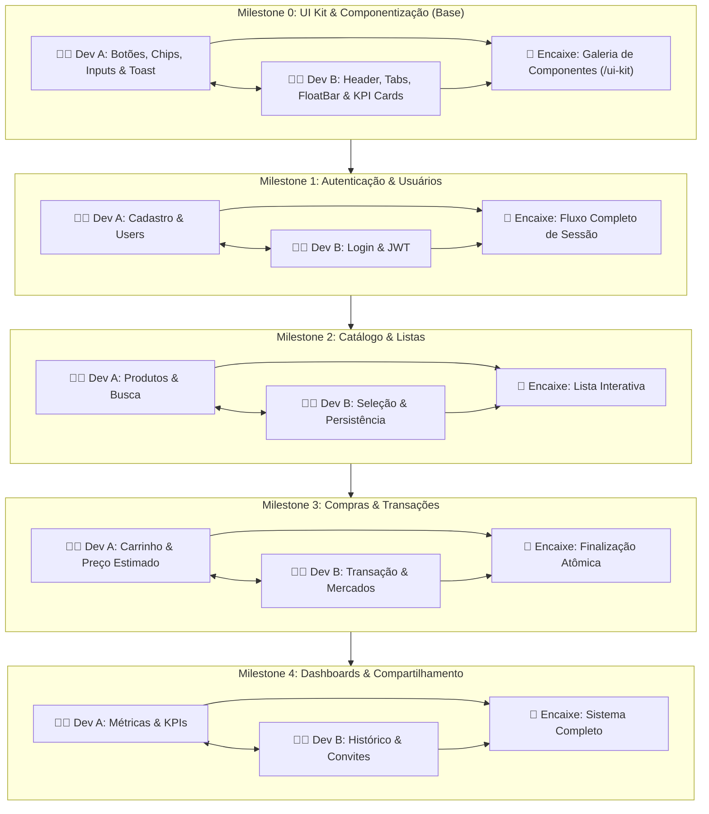

# 🧺 Plano de Engenharia e Mentoria: Projeto Feira & Cia (Full-Stack)

Este documento estabelece o plano diretor técnico, a governança de equipe e o **backlog executivo detalhado com subtarefas técnicas (checklists), contexto de produto e orientações de implementação** para capacitar dois desenvolvedores juniores em um ambiente de simulação real de empresa de tecnologia.

---

## 📌 Status Atual do Projeto (Entregas Realizadas)

As etapas fundamentais de infraestrutura, arquitetura e governança já foram **entregues e validadas**:

* ✅ **Monorepo TypeScript**: Workspaces `/apps/api` e `/apps/web` configurados.
* ✅ **Infraestrutura Docker**: PostgreSQL 16 pronto com `npm run docker:up` ou ambiente completo via `docker compose up --build`.
* ✅ **Backend Base (NestJS)**: Prisma ORM v6 integrado, Swagger ativo em `/api/docs`, CORS habilitado e pipes de validação globais.
* ✅ **Frontend Base (React Vite)**: Tailwind CSS v4, Google Fonts (Fraunces, DM Sans, Space Mono), tokens de cores temáticas, utilitários em `theme.ts` e tela de status operacional.
* ✅ **Governança Git Ativa**: Branch `main` protegida, `.github/CODEOWNERS` configurado (Derek como aprovador obrigatório), template de PR padronizado e repositório público no GitHub ([derek-alves/lista-de-compras](https://github.com/derek-alves/lista-de-compras)).

---

## 🎨 A Estratégia "Component-First": Por que criar o UI Kit Antes de Tudo?

Antes de mergulhar no backend e regras de negócio, a dupla passará pela **Milestone 0: Design System & UI Kit Reutilizável**.

### Por que essa abordagem é transformadora para um júnior?
1. **Evita JSX Espaguete**: Sem um kit pronto, juniores costumam recriar botões e inputs copiando e colando classes Tailwind em todas as páginas.
2. **Ensina os Fundamentos Mais Cobrados em Front-end**:
   * **Props Tipadas com TypeScript**: `interface ButtonProps extends React.ButtonHTMLAttributes<HTMLButtonElement>`.
   * **Variantes de Estilo e Estados**: Cores primárias, secundárias, ativo, desabilitado e estados de hover/focus.
   * **Composição de Componentes**: Uso de `children`, ícones via composição e slots.
3. **Showcase Visual Imediato**: Eles montam uma página de galeria (`/ui-kit`) onde você (Tech Lead) e eles conseguem visualizar e testar todos os componentes isolados antes de conectá-los com a API.

---

## 👥 Como a Dupla Trabalha: Trilhas Pareadas e Pontos de Encaixe



---

## 📋 Backlog de Engenharia com Contexto, Diretivas e Subtarefas

Abaixo estão as 26 tarefas sincronizadas com o GitHub Projects, contendo a orientação prática de implementação, contexto de produto, linha de raciocínio e checklist técnico.


### 🎨 Milestone 0: Design System & UI Kit Reutilizável (Component-First)

#### [ISSUE-00A] Componente `Button` com 4 Variantes de Mercado
* **Responsável Sugerido**: `dev-a`
* **O que deve ser feito nesta tarefa**:
  > Nessa tarefa vai ser necessário criar o componente `Button` existente no projeto padrão (`docs/lista-mercado.html`, linhas CSS 145-152, 210-215, 256-258 e linhas HTML 574, 577, 608). Vai ser necessário criar um componente que seja reutilizável, modular e fortemente tipado com TypeScript, atendendo às 4 variantes visuais da aplicação (`primary`, `light`, `clear-link`, `danger-outline`) para que todo o time utilize o mesmo padrão visual em qualquer tela.

* **Por que estamos fazendo isso? (Contexto de Produto)**:
  Em qualquer aplicação profissional, botões nunca devem ser tags `<button>` soltas com classes Tailwind espalhadas e duplicadas em 10 telas diferentes. Se amanhã o designer ou o cliente quiser mudar a cor de destaque ou o raio do arredondamento, você teria que alterar 30 arquivos manualmente.

Com este componente centralizado, qualquer ajuste de design é refletido em todo o sistema instantaneamente.

* **O que você precisa raciocinar antes de codar?**:
  1. **Variantes e Consistência**: O protótipo base utiliza 4 tipos visuais de botões:
   * `primary`: Botão vermelho chamativo de ação principal (usado para finalizar compra).
   * `light`: Botão com fundo creme e texto vermelho (usado em contraste dentro de barras escuras/vermelhas como a FloatBar).
   * `clear-link`: Botão sem fundo que parece um link sublinhado sutil (usado para "limpar seleção").
   * `danger-outline`: Botão vazado com borda vermelha (usado para ações destrutivas, como excluir compra).
2. **Acessibilidade e Tipagem**: O componente deve se comportar como um botão nativo do HTML. Ele precisa aceitar `onClick`, `type="button" | "submit"`, e o atributo `disabled` (quando desabilitado, deve diminuir a opacidade e desativar o clique).
3. **Composição Limpa**: Use `children` para permitir passar qualquer texto ou ícone dentro do botão.

* **Cenário Prático (Exemplo Real)**:
  ```tsx
// Exemplo de como os outros devs usarão seu componente:
<Button variant="primary">Finalizar compra</Button>
<Button variant="light">Iniciar compra →</Button>
<Button variant="clear-link" onClick={limpar}>limpar</Button>
<Button variant="danger-outline" size="sm">Excluir compra</Button>
```

* **Passo a Passo Técnico de Execução (Checklist)**:
* **Arquivo a ser criado**: `apps/web/src/components/ui/Button.tsx`
- [ ] Criar a interface `ButtonProps` estendendo `React.ButtonHTMLAttributes<HTMLButtonElement>`.
- [ ] Adicionar as props `variant?: 'primary' | 'light' | 'clear-link' | 'danger-outline'` e `size?: 'sm' | 'md' | 'lg'`.
- [ ] Configurar as classes do Tailwind para cada variante com transição suave no clique (`active:scale-95`).
- [ ] Tratar estado `disabled` (`disabled:opacity-40 disabled:cursor-not-allowed disabled:pointer-events-none`).
- [ ] Exportar usando `React.forwardRef` para garantir compatibilidade com formulários.
- [ ] *Referência no protótipo base*: [docs/lista-mercado.html](../lista-mercado.html#L145-L152).

---

#### [ISSUE-00B] Componentes de Entrada: `SearchBar` e `DateRowInput`
* **Responsável Sugerido**: `dev-a`
* **O que deve ser feito nesta tarefa**:
  > Nessa tarefa vai ser necessário criar os componentes de entrada `SearchBar` e `DateRowInput` existentes no projeto padrão (`docs/lista-mercado.html`, linhas CSS 84-94, 155-164 e HTML linhas 484-486, 513-516). Vai ser necessário criar componentes reutilizáveis para digitação rápida com limpeza de campo e seleção de data de compra formatada, prontos para receber eventos de digitação e alteração.

* **Por que estamos fazendo isso? (Contexto de Produto)**:
  No supermercado, a pessoa costuma usar o aplicativo segurando o celular com apenas uma mão enquanto empurra o carrinho com a outra. Os campos de digitação precisam ser confortáveis, com áreas de toque generosas, visual limpo e sem distrações visuais.

Você criará os dois componentes essenciais de entrada de dados do app: a barra de busca rápida de produtos e o seletor de data da compra.

* **O que você precisa raciocinar antes de codar?**:
  1. **SearchBar**: Precisa de um fundo marfim suave (`#fffdf7`) para não cansar a vista, ícone de lupa indicativo e botão rápido para limpar a digitação sem precisar apertar o backspace várias vezes.
2. **DateRowInput**: Em vez de um campo feio de formulário padrão, o protótipo agrupa o label em caixa alta e o input de data em um card elegante e flexível, utilizando a tipografia monoespaçada `Space Mono` para os dígitos da data.
3. **Data Padrão**: Se o usuário não selecionar nada, o campo já deve inicializar sugerindo a data de hoje.

* **Cenário Prático (Exemplo Real)**:
  * **SearchBar**: O usuário digita "café" -> dispara callback em tempo real para filtrar os produtos na tela.
* **DateRowInput**: Exibe "DATA DA COMPRA" e o seletor formatado (ex: `2026-11-16`).

* **Passo a Passo Técnico de Execução (Checklist)**:
* **Arquivos a serem criados**: `apps/web/src/components/ui/SearchBar.tsx` e `DateRowInput.tsx`
- [ ] Criar `SearchBar` com fundo marfim (`bg-[#fffdf7]`), borda 1px `border-line` e cantos arredondados (10px).
- [ ] Adicionar ícone de busca da biblioteca `lucide-react` e botão de limpar texto caso haja valor digitado.
- [ ] Criar `DateRowInput` com layout flex horizontal, label em caixa alta e input `type="date"` em `font-mono`.
- [ ] *Referência no protótipo base*: [docs/lista-mercado.html](../lista-mercado.html#L84-L94).

---

#### [ISSUE-00C] Componentes de Seleção: `ProductChip` e `CategoryDot`
* **Responsável Sugerido**: `dev-a`
* **O que deve ser feito nesta tarefa**:
  > Nessa tarefa vai ser necessário criar os componentes `ProductChip` e `CategoryDot` existentes no projeto padrão (`docs/lista-mercado.html`, linhas CSS 109-131, JS linhas 400-406 e HTML linhas 491-497). Vai ser necessário criar um componente altamente reutilizável para representar os itens do catálogo, que mude dinamicamente de estilo quando selecionado e dê feedback tátil ao usuário.

* **Por que estamos fazendo isso? (Contexto de Produto)**:
  O coração visual do Feira & Cia é a experiência de ticar itens na feira. Em vez de checkboxes comuns e sem graça, o app usa 'Chips' (pílulas coloridas) que representam as mercadorias. Quando a pessoa clica em um item, ele muda de cor e 'salta' aos olhos, dando a sensação de item marcado.

* **O que você precisa raciocinar antes de codar?**:
  1. **Estados Visuais Claros**:
   * *Estado Normal*: O produto não está na lista. Fundo creme neutro, texto escuro, com uma bolinha indicando a cor da sua categoria (ex: verde para legumes, vermelho para carnes).
   * *Estado Selecionado*: O produto foi escolhido para a compra. O chip se 'acende' sendo preenchido inteiramente com a cor da categoria, o texto fica creme em negrito e a bolinha interna vira branca.
2. **Feedback Tátil**: O clique precisa parecer um botão real sendo pressionado (`active:scale-95`).

* **Cenário Prático (Exemplo Real)**:
  * Usuário clica no chip "Tomate" (Legumes):
  * Antes: fundo `#fffdf7`, borda suave, bolinha verde.
  * Depois: fundo verde `#6E8B3D`, texto creme `#fff9ef`, bolinha branca.

* **Passo a Passo Técnico de Execução (Checklist)**:
* **Arquivo a ser criado**: `apps/web/src/components/ui/ProductChip.tsx`
- [ ] Criar o componente `CategoryDot` (círculo de 6px com cor dinâmica da categoria).
- [ ] Criar o `ProductChip` com cantos `rounded-full`, borda 1.5px e padding horizontal.
- [ ] Adicionar transição tátil de escala no clique (`active:scale-95`).
- [ ] Alternar estilos entre `isSelected === false` e `isSelected === true`.
- [ ] *Referência no protótipo base*: [docs/lista-mercado.html](../lista-mercado.html#L109-L131).

---

#### [ISSUE-00D] Feedback e Mensagens: `Toast` e `EmptyState`
* **Responsável Sugerido**: `dev-a`
* **O que deve ser feito nesta tarefa**:
  > Nessa tarefa vai ser necessário criar os componentes de feedback `Toast` e `EmptyState` existentes no projeto padrão (`docs/lista-mercado.html`, linhas CSS 165-168 e 260-265, e JS linhas 435-440). Vai ser necessário criar componentes reutilizáveis para exibir alertas temporários flutuantes na tela e mensagens amigáveis em telas sem conteúdo cadastrado.

* **Por que estamos fazendo isso? (Contexto de Produto)**:
  Uma boa aplicação nunca deixa o usuário sem resposta. Se ele finaliza uma compra, precisa de um feedback imediato confirmando o sucesso. Se uma aba está sem dados (ex: histórico vazio ou carrinho sem itens), ele precisa de uma mensagem clara orientando o que fazer em vez de uma tela em branco.

* **O que você precisa raciocinar antes de codar?**:
  1. **Toast Flutuante**: Deve aparecer na parte inferior da tela sem cobrir as ações principais, com fundo escuro elegante, texto claro e desaparecer sozinho após 2 segundos (auto-dismiss).
2. **EmptyState**: Em vez de deixar a tela crua, deve ter uma mensagem centralizada, tipografia confortável e incentivar a ação do usuário (ex: 'Sua lista está vazia. Volte para a aba Lista e selecione produtos.').

* **Cenário Prático (Exemplo Real)**:
  * Ao finalizar uma compra: Toast sobe suavemente com *"Compra salva! Total: R$ 85,40"* e some em 2s.
* Ao abrir o painel pela primeira vez: EmptyState exibe *"Nenhuma compra registrada ainda."*.

* **Passo a Passo Técnico de Execução (Checklist)**:
* **Arquivos a serem criados**: `apps/web/src/components/ui/Toast.tsx` e `EmptyState.tsx`
- [ ] Criar `Toast` fixo na parte inferior centralizada (`fixed bottom-24 left-1/2 -translate-x-1/2`).
- [ ] Implementar animação de subida e opacidade (`transition-all duration-300`).
- [ ] Adicionar temporizador automático de 2 segundos para fechamento.
- [ ] Criar `EmptyState` com mensagem centralizada, entrelinha agradável e suporte a ícone ou botão de ação.
- [ ] *Referência no protótipo base*: [docs/lista-mercado.html](../lista-mercado.html#L165-L168).

---

#### [ISSUE-00E] Estrutura e Navegação: `AppHeader`, `AppContainer` e `TabsNav`
* **Responsável Sugerido**: `dev-b`
* **O que deve ser feito nesta tarefa**:
  > Nessa tarefa vai ser necessário criar os componentes estruturais `AppHeader`, `AppContainer` e `TabsNav` existentes no projeto padrão (`docs/lista-mercado.html`, linhas CSS 40-77 e HTML linhas 475-481). Vai ser necessário criar a casca reutilizável do layout com container centralizado de até 520px para celulares, cabeçalho verde com tipografia serifada e navegação fluida por abas.

* **Por que estamos fazendo isso? (Contexto de Produto)**:
  O Feira & Cia foi concebido como um web app com experiência mobile-first (pensado para telas de celular). Toda a interface é sustentada por uma estrutura consistente: um topo verde escuro marcante que remete às lonas de barracas de feira tradicional, uma navegação simples por abas e um container centralizado.

* **O que você precisa raciocinar antes de codar?**:
  1. **AppContainer**: Em telas de desktop, o app não deve esticar ocupando a tela inteira (isso destruiria o design mobile). Ele deve ter largura máxima fixa de 520px e ficar centralizado.
2. **AppHeader**: Fixo no topo (`sticky top-0`) com o título serifado em fonte `Fraunces`, slogan em itálico e cor verde `--awning`.
3. **TabsNav**: Três abas de navegação ("Lista", "Compra", "Painel") com borda superior arredondada. A aba selecionada ganha o fundo creme da página, criando a ilusão de pasta aberta.

* **Cenário Prático (Exemplo Real)**:
  * O usuário navega entre as seções tocando em [Lista], [Compra] ou [Painel], com transição visual instantânea da aba ativa.

* **Passo a Passo Técnico de Execução (Checklist)**:
* **Arquivos a serem criados**: `apps/web/src/components/ui/AppHeader.tsx`, `AppContainer.tsx` e `TabsNav.tsx`
- [ ] Criar `AppContainer` com `max-w-[520px] mx-auto min-h-screen flex flex-col pb-24`.
- [ ] Criar `AppHeader` fixo no topo (`sticky top-0 z-20`) em fundo verde `--awning`, com título e slogan.
- [ ] Criar `TabsNav` com as 3 abas, cantos arredondados no topo (`rounded-t-lg`) e estilização da aba ativa.
- [ ] Disparar callback `onTabChange(tabName)` quando o usuário clica em uma aba.
- [ ] *Referência no protótipo base*: [docs/lista-mercado.html](../lista-mercado.html#L40-L77).

---

#### [ISSUE-00F] Cabeçalho de Categoria: `CategoryHeader`
* **Responsável Sugerido**: `dev-b`
* **O que deve ser feito nesta tarefa**:
  > Nessa tarefa vai ser necessário criar o componente de agrupamento `CategoryHeader` existente no projeto padrão (`docs/lista-mercado.html`, linhas CSS 95-108 e JS linhas 389-395). Vai ser necessário criar um componente reutilizável de título de seção que exiba o nome da categoria, emoji ilustrativo e a barra lateral vertical colorida de 5px correspondente a cada setor do mercado.

* **Por que estamos fazendo isso? (Contexto de Produto)**:
  No supermercado e na feira, as mercadorias são organizadas por setores (hortifruti, açougue, padaria, limpeza). Para que a tela de seleção não seja um amontoado caótico de 80 produtos, o catálogo precisa de divisões de seção nítidas e coloridas.

* **O que você precisa raciocinar antes de codar?**:
  1. **Identidade Visual por Cores**: Cada categoria possui uma cor própria. O cabeçalho deve destacar essa cor através de uma barra lateral vertical de 5px (`border-l-[5px]`).
2. **Semântica e Acessibilidade**: Deve combinar um emoji temático (ex: 🧼, 🥩, 🥖) com o título da seção em fonte serifada `Fraunces` para dar charme e elegância ao produto.

* **Cenário Prático (Exemplo Real)**:
  * Renderiza: Barra verde à esquerda + 🥕 + "Legumes"
* Renderiza: Barra marrom à esquerda + 🛒 + "Mercearia" 

* **Passo a Passo Técnico de Execução (Checklist)**:
* **Arquivo a ser criado**: `apps/web/src/components/ui/CategoryHeader.tsx`
- [ ] Criar cabeçalho flexível recebendo `name: string`, `icon: string` e `colorVar: string`.
- [ ] Aplicar a barra lateral vertical de 5px com a cor dinâmica da categoria (`border-l-[5px]`).
- [ ] Estilizar o título em fonte `font-serif` (Fraunces) de 16px.
- [ ] *Referência no protótipo base*: [docs/lista-mercado.html](../lista-mercado.html#L95-L108).

---

#### [ISSUE-00G] Barras Flutuantes: `FloatBar` e `ReceiptBar`
* **Responsável Sugerido**: `dev-b`
* **O que deve ser feito nesta tarefa**:
  > Nessa tarefa vai ser necessário criar as barras de rodapé flutuantes `FloatBar` e `ReceiptBar` existentes no projeto padrão (`docs/lista-mercado.html`, linhas CSS 132-152 e 190-216, e HTML linhas 500-505, 570-578). Vai ser necessário criar componentes reutilizáveis fixos no final da tela, exibindo contadores de itens selecionados e o total do cupom fiscal com visual serrilhado rasgado.

* **Por que estamos fazendo isso? (Contexto de Produto)**:
  Ao rolar uma lista com dezenas de itens no celular, o usuário não pode ter que rolar tudo de volta até o topo para saber quantos produtos já selecionou ou para finalizar a compra. As ações principais precisam estar sempre ao alcance do polegar.

* **O que você precisa raciocinar antes de codar?**:
  1. **FloatBar (Aba Lista)**:
   * Barra fixa no rodapé em vermelho forte com sombra marcante.
   * Só deve aparecer se houver pelo menos 1 item selecionado (se o contador for zero, ela se oculta automaticamente).
   * Lado esquerdo: link discreto "limpar" e a contagem (ex: "5 itens selecionados").
   * Lado direito: botão claro de contraste "Iniciar compra →".
2. **ReceiptBar (Aba Compra)**:
   * Simula um cupom fiscal de mercado com o acabamento de borda serrilhada no topo (efeito `.receipt-torn` via gradiente CSS).
   * Exibe o total acumulado grande em fonte monoespaçada e botão de largura total "Finalizar compra".

* **Cenário Prático (Exemplo Real)**:
  * Na aba Lista: ao tocar no 1º produto, a barra vermelha surge no rodapé com "1 item selecionado".
* Na aba Compra: a barra verde com topo rasgado mostra "TOTAL DA COMPRA: R$ 142,50".

* **Passo a Passo Técnico de Execução (Checklist)**:
* **Arquivos a serem criados**: `apps/web/src/components/ui/FloatBar.tsx` e `ReceiptBar.tsx`
- [ ] Criar `FloatBar` fixa no rodapé (`fixed bottom-0 z-30`), fundo `--accent`, contador e botões.
- [ ] Ocultar a `FloatBar` automaticamente caso a contagem seja zero (`count === 0`).
- [ ] Criar `ReceiptBar` com classe `.receipt-torn` no topo, total grande em `font-mono` e botão de finalizar.
- [ ] Desabilitar o botão de finalizar se o valor total for zero.
- [ ] *Referência no protótipo base*: [docs/lista-mercado.html](../lista-mercado.html#L132-L152).

---

#### [ISSUE-00H] Dashboards: `KpiCard`, `CategoryProgressBar` e `PurchaseHistoryCard`
* **Responsável Sugerido**: `dev-b`
* **O que deve ser feito nesta tarefa**:
  > Nessa tarefa vai ser necessário criar os componentes do painel `KpiCard`, `CategoryProgressBar` e `PurchaseHistoryCard` existentes no projeto padrão (`docs/lista-mercado.html`, linhas CSS 225-258 e HTML linhas 594-610). Vai ser necessário criar componentes reutilizáveis para exibir cartões de métricas financeiras, barras percentuais de gastos por categoria e cards expansíveis de compras passadas.

* **Por que estamos fazendo isso? (Contexto de Produto)**:
  Depois que as compras são feitas, o usuário quer entender para onde o dinheiro dele foi. A aba Painel transforma números brutos em inteligência financeira: indicadores chave (KPIs), comparativo de gastos por categoria e histórico de comprovantes passados.

* **O que você precisa raciocinar antes de codar?**:
  1. **KpiCard**: Exibe métricas de topo como "TOTAL GASTO", "COMPRAS FEITAS" e "MÉDIA POR COMPRA". Precisa de tipografia monoespaçada marcante e rótulo em caixa alta.
2. **CategoryProgressBar**: Barra horizontal proporcional exibindo quanto foi gasto naquela categoria (ex: "🥩 Carnes: R$ 120,00 (45%)").
3. **PurchaseHistoryCard**: Cartão expansível de compra passada mostrando data, mercado, total e botão para ver itens ou excluir.

* **Cenário Prático (Exemplo Real)**:
  * Renderiza card KPI: "TOTAL GASTO / R$ 420,80".
* Renderiza barra de categoria: "🥕 Legumes (R$ 45,00) [████░░░░░░] 22%".

* **Passo a Passo Técnico de Execução (Checklist)**:
* **Arquivos a serem criados**: `apps/web/src/components/ui/KpiCard.tsx`, `CategoryProgressBar.tsx` e `PurchaseHistoryCard.tsx`
- [ ] Criar `KpiCard` com label em caixa alta e valor em `font-mono text-xl`.
- [ ] Criar `CategoryProgressBar` com indicador percentual e preenchimento colorido dinâmico.
- [ ] Criar `PurchaseHistoryCard` com detalhes da compra e suporte a clique de exclusão/expansão.
- [ ] *Referência no protótipo base*: [docs/lista-mercado.html](../lista-mercado.html#L225-L258).

---


### 🟢 Milestone 1: Autenticação e Gestão de Usuários

#### [ISSUE-01] Backend: Modelagem e CRUD de Usuários com Bcrypt
* **Responsável Sugerido**: `dev-a`
* **O que deve ser feito nesta tarefa**:
  > Nessa tarefa vai ser necessário implementar a base de usuários do sistema no backend (`apps/api`). No projeto padrão (`docs/lista-mercado.html`), tudo era salvo em um único `localStorage` do navegador sem contas nem segurança. Vai ser necessário criar a entidade `User` no Prisma, criar a rota de cadastro com hash seguro de senha via `bcrypt` e validação com DTOs.

* **Por que estamos fazendo isso? (Contexto de Produto)**:
  O protótipo inicial salvava tudo no navegador local, impossibilitando que duas pessoas tivessem contas separadas ou que um usuário acessasse suas compras pelo computador e pelo celular. Para um produto comercial real, o primeiro passo é dar identidade e segurança ao usuário.

* **O que você precisa raciocinar antes de codar?**:
  1. **Segurança de Senhas**: Senhas nunca devem ser salvas em texto puro no banco de dados. Use `bcrypt` com salt de 10 rounds para gerar o hash.
2. **Unicidade de Email**: O campo email precisa ter índice `@unique` no banco de dados para evitar contas duplicadas.
3. **Sanitização de Resposta**: Ao retornar os dados do usuário após o cadastro, o campo `password` DEVE ser omitido da resposta JSON por motivos óbvios de segurança.

* **Cenário Prático (Exemplo Real)**:
  * Requisição: `POST /api/users` com `{"name": "Carlos", "email": "carlos@email.com", "password": "senhaSegura123"}`.
* Resposta: HTTP 201 Created com `{"id": "uuid-...", "name": "Carlos", "email": "carlos@email.com", "createdAt": "..."}`.

* **Estratégia de Testes para esta Tarefa**:
    🧪 Estratégia Gradual de Testes (Fase 1 - Educativa / Aprendizado)
Nesta tarefa você escreverá seu primeiro teste unitário no backend (`apps/api/src/users/users.service.spec.ts`).

* **O que você vai testar**:
  1. Garantir que o método `createUser` criptografa a senha com `bcrypt` antes de salvar no banco.
  2. Garantir que o campo `password` NUNCA seja retornado no objeto JSON de resposta.
  3. Simular a tentativa de cadastrar um email já existente e verificar se o NestJS lança a exceção esperada (`ConflictException`).
* **Como funciona o CI nesta fase**:
  * O teste serve como seu laboratório de aprendizado para entender Jest e Mocks sem pressão.
  * O CI exigirá a compilação do TypeScript obrigatória (`npm run build`), mas o teste unitário ainda não travará o merge caso você precise de ajuda ou feedback do mentor no PR.

* **Passo a Passo Técnico de Execução (Checklist)**:
* **Local**: `apps/api/src/users/` e `prisma/schema.prisma`
- [ ] Configurar modelo `User` no Prisma (`id`, `name`, `email`, `password`, `createdAt`, `updatedAt`).
- [ ] Criar `CreateUserDto` usando `class-validator` (`@IsEmail()`, `@MinLength(6)`).
- [ ] Implementar serviço de hash de senha com `bcrypt`.
- [ ] Criar controller com endpoint `POST /api/users` retornando o usuário sem o hash da senha.
- [ ] Escrever teste unitário para garantir que senhas duplicadas ou inválidas sejam rejeitadas.

---

#### [ISSUE-02] Frontend: Tela e Formulário de Cadastro com Zod
* **Responsável Sugerido**: `dev-b`
* **O que deve ser feito nesta tarefa**:
  > Nessa tarefa vai ser necessário criar a tela e o formulário de cadastro de usuário no frontend (`apps/web`). Como o projeto padrão (`docs/lista-mercado.html`) não possuía tela de cadastro, vai ser necessário criar uma tela limpa e amigável utilizando React Hook Form integrado com Zod para validar campos como nome, email e senha com feedback de erro em tempo real.

* **Por que estamos fazendo isso? (Contexto de Produto)**:
  O formulário de cadastro é a porta de entrada da aplicação. Se for confuso, demorado ou não der mensagens de erro claras (ex: avisar que a senha precisa ter no mínimo 6 dígitos antes de enviar para o servidor), o usuário desiste antes mesmo de conhecer o produto.

* **O que você precisa raciocinar antes de codar?**:
  1. **Validação no Cliente**: Validar os dados antes de disparar a requisição HTTP economiza recursos do servidor e oferece feedback instantâneo ao usuário.
2. **Design Consistente**: A tela de registro deve utilizar as mesmas cores de marca (`--cream`, `--awning`), tipografia serifada e o componente `Button` criado no Milestone 0.
3. **Tratamento de Conflito**: Se a API retornar erro HTTP 409 (Email já cadastrado), o formulário deve exibir um alerta vermelho elegante orientando o usuário a fazer login.

* **Cenário Prático (Exemplo Real)**:
  * O usuário digita um email inválido `carlos@` -> O campo exibe em vermelho: *"Informe um email válido"*.
* Ao preencher corretamente e clicar em "Criar Conta", o usuário é automaticamente redirecionado para a tela de login.

* **Estratégia de Testes para esta Tarefa**:
    🧪 Estratégia Gradual de Testes (Fase 1 - Educativa / Frontend)
Nesta tarefa você criará um teste unitário simples para o schema de validação do Zod (`apps/web/src/schemas/register.schema.spec.ts`).

* **O que você vai testar**:
  1. Verificar se um formulário com email inválido (ex: `teste@`) é prontamente rejeitado pelo Zod.
  2. Verificar se uma senha com menos de 6 caracteres dispara a mensagem de erro esperada.
  3. Verificar se dados válidos e com confirmação de senha idêntica passam com sucesso.
* **Por que começar testando schemas**:
  * Testar regras puras do Zod é a forma mais leve e prazerosa de aprender testes no front (`vitest`), sem precisar lidar com complexidades de DOM ou renderização de telas!

* **Passo a Passo Técnico de Execução (Checklist)**:
* **Local**: `apps/web/src/pages/RegisterPage.tsx`
- [ ] Criar esquema de validação Zod (`name`: min 2 chars, `email`: válido, `password`: min 6 chars).
- [ ] Integrar formulário com `react-hook-form` e `@hookform/resolvers/zod`.
- [ ] Reutilizar o componente `Button` da Milestone 0 para a ação de envio com estado de loading.
- [ ] Conectar chamada HTTP `POST /api/users` utilizando a instância do Axios (`api.ts`).
- [ ] Adicionar link de navegação para a tela de Login.

---

#### [ISSUE-03] Backend: Autenticação JWT, Refresh Token e Guards
* **Responsável Sugerido**: `dev-a`
* **O que deve ser feito nesta tarefa**:
  > Nessa tarefa vai ser necessário implementar a camada completa de autenticação no backend (`apps/api`). Vai ser necessário criar o fluxo de login com JWT e cookies seguros `HttpOnly`, criar o `JwtAuthGuard` para proteger as rotas do sistema e criar o endpoint de verificação de sessão `/api/auth/me`.

* **Por que estamos fazendo isso? (Contexto de Produto)**:
  Sem autenticação por token, qualquer pessoa poderia fazer requisições para a API e bisbilhotar ou apagar as listas de outros clientes. O JWT (JSON Web Token) é o padrão da indústria para garantir que cada requisição carregue a identidade comprovada de quem a enviou.

* **O que você precisa raciocinar antes de codar?**:
  1. **Segurança Máxima com Cookies HttpOnly**: Guardar tokens JWT no `localStorage` do frontend é uma vulnerabilidade grave a ataques XSS (Cross-Site Scripting). O token deve ser enviado pelo backend em um cookie `HttpOnly`, inacessível via JavaScript malicioso.
2. **Guarda de Rotas (Guard)**: Criar um decorator `@UseGuards(JwtAuthGuard)` reutilizável que bloqueie qualquer requisição não autenticada com HTTP 401 Unauthorized.
3. **Endpoint de Sessão**: O endpoint `GET /api/auth/me` deve ler o cookie/token e devolver os dados do usuário autenticado.

* **Cenário Prático (Exemplo Real)**:
  * Requisição: `POST /api/auth/login` com credenciais corretas -> Resposta HTTP 200 com Set-Cookie HttpOnly e dados básicos do usuário.

* **Estratégia de Testes para esta Tarefa**:
    🧪 Estratégia Gradual de Testes (Fase 1 - Educativa / Autenticação)
Escrever testes unitários em `apps/api/src/auth/auth.service.spec.ts`.

* **O que você vai testar**:
  1. Verificar se o método `login` gera um token JWT válido assinado com a chave secreta.
  2. Verificar se a tentativa de login com senha incorreta é bloqueada com `UnauthorizedException` (HTTP 401).
* **Como funciona o CI nesta fase**:
  * Você valida a lógica de autenticação com segurança. O CI continuará validando a compilação de toda a aplicação de forma bloqueante.

* **Passo a Passo Técnico de Execução (Checklist)**:
* **Local**: `apps/api/src/auth/`
- [ ] Instalar e configurar `@nestjs/jwt` e `@nestjs/passport` com `passport-jwt`.
- [ ] Implementar validação de credenciais comparando senha com hash via `bcrypt`.
- [ ] Configurar envio do token via Cookie `HttpOnly` com flags `Secure` e `SameSite`.
- [ ] Criar `JwtAuthGuard` para proteger endpoints privados.
- [ ] Criar endpoint `GET /api/auth/me` para checar o usuário ativo na sessão.

---

#### [ISSUE-04] Frontend: Tela de Login e Contexto de Autenticação (`AuthContext`)
* **Responsável Sugerido**: `dev-b`
* **O que deve ser feito nesta tarefa**:
  > Nessa tarefa vai ser necessário criar a tela de login e o gerenciador de estado global de autenticação (`AuthContext`) no frontend (`apps/web`). Vai ser necessário integrar a tela com a API, salvar o estado do usuário logado, proteger as rotas da aplicação e manter a sessão persistente mesmo após recarregar o navegador.

* **Por que estamos fazendo isso? (Contexto de Produto)**:
  Quando o usuário abre o aplicativo, o app precisa saber imediatamente se ele já está logado ou se deve ser enviado para a tela de login. Centralizar esse estado no `AuthContext` evita que cada página precise checar o login por conta própria.

* **O que você precisa raciocinar antes de codar?**:
  1. **Persistência Suave**: Ao inicializar o app, o `AuthContext` deve disparar uma chamada para `GET /api/auth/me`. Se o cookie for válido, o usuário entra direto sem precisar digitar senha novamente.
2. **Rotas Protegidas**: Se um usuário não autenticado tentar entrar na URL `/lista`, ele deve ser interceptado e redirecionado para `/login`.
3. **Função de Logout**: Deve limpar o estado em memória e chamar o endpoint de logout para invalidar o cookie.

* **Cenário Prático (Exemplo Real)**:
  * Usuário acessa o app -> Tela de carregamento rápido (spinner) checa a sessão -> Usuário autenticado vai direto para a aba de Lista de compras.

* **Passo a Passo Técnico de Execução (Checklist)**:
* **Local**: `apps/web/src/pages/LoginPage.tsx` e `apps/web/src/contexts/AuthContext.tsx`
- [ ] Criar formulário de Login com `react-hook-form` e validação Zod.
- [ ] Criar `AuthContext` provendo `user`, `login`, `logout` e `isLoading`.
- [ ] Interceptar respostas HTTP 401 no cliente Axios para deslogar automaticamente caso a sessão expire.
- [ ] Criar componente `ProtectedRoute` para envelopar as abas privadas do aplicativo.

---


### 🟡 Milestone 2: Catálogo de Produtos e Gestão de Listas

#### [ISSUE-05] Backend: Seed do Banco com as 10 Categorias e Produtos
* **Responsável Sugerido**: `dev-a`
* **O que deve ser feito nesta tarefa**:
  > Nessa tarefa vai ser necessário criar o script de seed do banco de dados no backend (`apps/api/prisma/seed.ts`), migrando toda a lista de categorias e mercadorias pré-cadastradas existentes no projeto padrão (`docs/lista-mercado.html`, linhas JS 290-330). Vai ser necessário popular as 10 categorias com suas respectivas cores, ícones e dezenas de produtos padrão para que a aplicação já nasça recheada de itens prontos para uso.

* **Por que estamos fazendo isso? (Contexto de Produto)**:
  Ninguém quer começar a usar um aplicativo de compras com uma tela 100% vazia onde você precisa cadastrar até o arroz e o feijão do zero. O protótipo já vinha com dezenas de produtos clássicos da feira brasileira organizados por setor.

* **O que você precisa raciocinar antes de codar?**:
  1. **Idempotência do Seed**: O script de seed deve poder ser executado 10 vezes seguidas sem duplicar categorias nem dar erro de chave única (use `upsert`).
2. **Cores e Ícones**: Cada uma das 10 categorias (Hortifruti, Carnes, Laticínios, Mercearia, Bebidas, etc.) precisa guardar sua cor hexadecimal oficial e seu emoji no banco de dados.
3. **Produtos Padrão do Sistema**: Produtos iniciais devem ter a flag `isCustom: false` para indicar que são itens globais da plataforma.

* **Cenário Prático (Exemplo Real)**:
  * Executar `npm run prisma:seed` -> Insere automaticamente as 10 categorias e os mais de 70 produtos (Banana, Alface, Picanha, Leite, etc.) no banco PostgreSQL.

* **Passo a Passo Técnico de Execução (Checklist)**:
* **Local**: `apps/api/prisma/seed.ts`
- [ ] Extrair os dados mockados de categorias e itens de `docs/lista-mercado.html` (linhas 290 a 330).
- [ ] Escrever lógica com `prisma.category.upsert` para garantir que o seed seja idempotente.
- [ ] Associar cada produto à sua respectiva categoria via chave estrangeira `categoryId`.
- [ ] Adicionar script `"seed": "ts-node prisma/seed.ts"` no `package.json` da API.

---

#### [ISSUE-06] Backend: API de Listagem e Criação de Produtos
* **Responsável Sugerido**: `dev-a`
* **O que deve ser feito nesta tarefa**:
  > Nessa tarefa vai ser necessário criar o módulo de produtos no backend (`apps/api/src/products/`), migrando a lógica de catálogo existente no projeto padrão (`docs/lista-mercado.html`, linhas JS 331-380). Vai ser necessário criar endpoints REST para listar produtos agrupados por categoria, buscar por texto e permitir que o usuário cadastre novos produtos customizados.

* **Por que estamos fazendo isso? (Contexto de Produto)**:
  O catálogo de produtos precisa ser dinâmico. Além dos itens globais que vêm de fábrica, se o usuário quiser adicionar um item específico (ex: "Kombucha de Maracujá" ou "Ração do Pet"), o backend deve permitir o cadastro desse novo produto vinculado à conta dele.

* **O que você precisa raciocinar antes de codar?**:
  1. **Busca Eficiente**: O endpoint de listagem deve aceitar query param `?search=cafe` e filtrar com `contains` case-insensitive no Prisma.
2. **Visibilidade de Produtos**: O catálogo retornado para o usuário deve ser a soma de: (Produtos globais do sistema) + (Produtos customizados criados por aquele usuário).
3. **Agrupamento Otimizado**: Retornar os produtos já aninhados em suas respectivas categorias economiza dezenas de filtros no frontend.

* **Cenário Prático (Exemplo Real)**:
  * `GET /api/products?search=maca` -> Retorna `[{"id": 1, "name": "Maçã Gala", "category": {"name": "Frutas", "color": "#E55353"}}]`.

* **Passo a Passo Técnico de Execução (Checklist)**:
* **Local**: `apps/api/src/products/`
- [ ] Criar `ProductsController` e `ProductsService` no NestJS.
- [ ] Implementar `GET /api/products` com filtro de busca e agrupamento por categoria.
- [ ] Implementar `POST /api/products` com validação de nome e categoria para itens customizados.
- [ ] Proteger as rotas com `JwtAuthGuard`.

---

#### [ISSUE-07] Frontend: Aba Lista com os Componentes Reutilizáveis
* **Responsável Sugerido**: `dev-b`
* **O que deve ser feito nesta tarefa**:
  > Nessa tarefa vai ser necessário construir a tela principal de seleção de compras (Aba Lista) no frontend (`apps/web`), migrando a interface do projeto padrão (`docs/lista-mercado.html`, linhas HTML 482-506). Vai ser necessário consumir os componentes reutilizáveis criados no Milestone 0 (`SearchBar`, `CategoryHeader`, `ProductChip`, `FloatBar`) e conectar a busca dinâmica por texto.

* **Por que estamos fazendo isso? (Contexto de Produto)**:
  Esta é a tela onde o usuário passa mais tempo antes de sair de casa para a feira: marcando quais legumes, carnes e mantimentos estão faltando na despensa. A interface precisa ser extremamente fluida e agradável.

* **O que você precisa raciocinar antes de codar?**:
  1. **Composição em Vez de Duplicação**: Todas as seções e chips devem usar os componentes prontos do Milestone 0 (`CategoryHeader`, `ProductChip`, `SearchBar`).
2. **Filtragem Instantânea**: Conforme o usuário digita na barra de busca, os produtos que não correspondem ao texto devem desaparecer suavemente da listagem.
3. **Botão de Adicionar Produto**: Se o usuário não encontrar o que procura na busca, deve haver um botão discreto "+ Adicionar outro item" para abrir o modal de cadastro.

* **Cenário Prático (Exemplo Real)**:
  * Usuário clica na barra de busca, digita "leite" -> A lista filtra na hora exibindo apenas Leite Integral e Leite Desnatado na seção Laticínios.

* **Passo a Passo Técnico de Execução (Checklist)**:
* **Local**: `apps/web/src/pages/ListPage.tsx`
- [ ] Buscar produtos da API via `GET /api/products` usando React Query / Hook customizado.
- [ ] Renderizar categorias utilizando `CategoryHeader` e produtos com `ProductChip`.
- [ ] Conectar o valor da `SearchBar` ao estado de filtro da listagem.
- [ ] Exibir botão de ação para abrir o modal de criação de produto customizado.

---

#### [ISSUE-08] Frontend: ListContext e Conexão com a FloatBar
* **Responsável Sugerido**: `dev-b`
* **O que deve ser feito nesta tarefa**:
  > Nessa tarefa vai ser necessário criar o estado global da lista de compras (`ListContext`) no frontend (`apps/web`), substituindo a manipulação direta do DOM existente no projeto padrão (`docs/lista-mercado.html`, linhas JS 385-408). Vai ser necessário gerenciar itens marcados/desmarcados, sincronizar a contagem em tempo real com a `FloatBar` e permitir a transição para a aba de compra.

* **Por que estamos fazendo isso? (Contexto de Produto)**:
  No protótipo original de arquivo único, quando o usuário clicava em um item, o JavaScript alterava classes do DOM diretamente (`chip.classList.toggle('active')`). No React profissional, todo estado deve ser gerenciado de forma reativa e centralizada.

* **O que você precisa raciocinar antes de codar?**:
  1. **Estado Reativo**: Manter uma lista de IDs ou objetos de itens selecionados `selectedItems: ListItem[]`.
2. **Sincronização com FloatBar**: Quando `selectedItems.length > 0`, a `FloatBar` aparece suavemente no rodapé com o número de itens selecionados.
3. **Ação de Limpar**: O link "limpar" da FloatBar deve zerar a seleção de uma só vez, desmarcando todos os chips na tela instantaneamente.

* **Cenário Prático (Exemplo Real)**:
  * Clicar em "Banana" -> `selectedItems` ganha 1 item -> `FloatBar` surge no rodapé exibindo "1 item selecionado" e botão "Iniciar compra →".

* **Passo a Passo Técnico de Execução (Checklist)**:
* **Local**: `apps/web/src/contexts/ListContext.tsx`
- [ ] Criar `ListProvider` gerenciando itens selecionados, adição, remoção e limpeza total.
- [ ] Conectar os chips da tela `ListPage` ao método `toggleItem(productId)`.
- [ ] Conectar o total de itens selecionados na `FloatBar` do rodapé.
- [ ] Fazer o botão "Iniciar compra →" alternar a aba ativa para "Compra".

---

#### [ISSUE-09] Full-stack: Persistência da Lista Ativa no Backend
* **Responsável Sugerido**: `dev-a`
* **O que deve ser feito nesta tarefa**:
  > Nessa tarefa vai ser necessário implementar a sincronização e persistência da lista de compras ativa no banco de dados (`apps/api` e `apps/web`). No projeto padrão (`docs/lista-mercado.html`), se a pessoa trocasse de dispositivo a lista não existia. Vai ser necessário salvar a lista de compras vinculada ao usuário logado, permitindo que ele continue a compra em qualquer celular ou navegador.

* **Por que estamos fazendo isso? (Contexto de Produto)**:
  Imagine montar toda a lista de compras no computador de mesa e, ao chegar no supermercado com o celular, descobrir que a lista sumiu porque ficou salva apenas na memória do computador. Uma aplicação moderna sincroniza a lista ativa do usuário na nuvem.

* **O que você precisa raciocinar antes de codar?**:
  1. **Entidade ShoppingList**: Cada usuário possui uma lista ativa corrente (`status: "ACTIVE"`).
2. **Debounce de Salvamento**: No frontend, ao selecionar itens rapidamente, podemos usar um debounce de 500ms para persistir as alterações na API sem sobrecarregar o servidor com dezenas de requisições por segundo.
3. **Carregamento Inicial**: Ao abrir o app, a lista ativa deve ser hidratada com os itens já salvos no banco.

* **Cenário Prático (Exemplo Real)**:
  * Usuário marca 5 produtos no PC -> Abre o app no celular -> Os mesmos 5 produtos já aparecem selecionados e prontos para a feira.

* **Passo a Passo Técnico de Execução (Checklist)**:
* **Local**: `apps/api/src/lists/` e `apps/web/src/contexts/ListContext.tsx`
- [ ] Criar endpoints `GET /api/lists/active` e `PUT /api/lists/active/items` no backend.
- [ ] Tratar relacionamentos no Prisma (`ShoppingList` 1:N `ListItem`).
- [ ] No frontend, sincronizar o `ListContext` com o backend ao alterar itens.
- [ ] Adicionar indicador visual sutil de salvamento automático ("Sincronizado").

---


### 🟠 Milestone 3: Modo de Compra Ativa e Fechamento de Pedido

#### [ISSUE-10] Frontend: Aba de Compra (Carrinho em Tempo Real)
* **Responsável Sugerido**: `dev-b`
* **O que deve ser feito nesta tarefa**:
  > Nessa tarefa vai ser necessário construir a tela do carrinho de compras ativo (Aba Compra) no frontend (`apps/web`), migrando a interface do projeto padrão (`docs/lista-mercado.html`, linhas HTML 507-578 e JS linhas 409-430). Vai ser necessário permitir que o usuário altere quantidades, unidades de medida, informe preços pagos por item e visualize o cálculo em tempo real do total acumulado.

* **Por que estamos fazendo isso? (Contexto de Produto)**:
  Esta é a tela utilizada dentro do mercado, em meio aos corredores. Cada item marcado ganha campos para registrar a quantidade comprada (ex: 2 kg, 1 un), o supermercado onde está sendo realizada a compra e o valor unitário digitado na hora.

* **O que você precisa raciocinar antes de codar?**:
  1. **Cálculo Reativo em Tempo Real**: Total = Soma de `(quantidade * precoUnitario)` de todos os itens. Qualquer número digitado em qualquer campo deve recalcular o valor da barra de rodapé instantaneamente sem engasgos.
2. **Formatação de Moeda Brasileira**: Exibir os valores sempre no padrão `R$ 12,50` utilizando o formatador `formatMoney` de `theme.ts`.
3. **EmptyState**: Se o usuário entrar na aba Compra sem nenhum item selecionado, exibir o componente `EmptyState` avisando que o carrinho está vazio.

* **Cenário Prático (Exemplo Real)**:
  * Usuário insere 3 unidades de Leite a R$ 4,50 -> Subtotal do leite vira R$ 13,50 -> Total da `ReceiptBar` atualiza na hora para R$ 13,50.

* **Passo a Passo Técnico de Execução (Checklist)**:
* **Local**: `apps/web/src/pages/CartPage.tsx`
- [ ] Renderizar cada item selecionado com seletor de quantidade e unidade (kg, g, un, cx).
- [ ] Adicionar campo de input de preço com máscara monetária.
- [ ] Conectar com a `ReceiptBar` exibindo a somatória acumulada.
- [ ] Exibir `EmptyState` caso não haja nenhum produto no carrinho.

---

#### [ISSUE-11] Full-stack: Preenchimento com o Último Preço Pago
* **Responsável Sugerido**: `dev-a`
* **O que deve ser feito nesta tarefa**:
  > Nessa tarefa vai ser necessário implementar a funcionalidade de histórico inteligente de preços (`apps/api` e `apps/web`), aprimorando a lógica existente no projeto padrão (`docs/lista-mercado.html`, linhas JS 350-365). Quando o usuário adicionar um produto ao carrinho, o sistema deve sugerir automaticamente o último preço que ele pagou por aquele item naquele supermercado.

* **Por que estamos fazendo isso? (Contexto de Produto)**:
  Uma das maiores dores de quem faz compras é a inflação: saber se o café ou o óleo de soja aumentou de preço em relação à última semana. Ter uma sugestão automática do preço pago na última compra poupa tempo de digitação e dá referência imediata de economia.

* **O que você precisa raciocinar antes de codar?**:
  1. **Consulta Histórica Eficiente**: Ao solicitar os itens da compra, o backend busca a última compra finalizada do usuário que continha aquele produto e retorna o valor pago.
2. **Placeholder Inteligente**: Se o café custou R$ 18,90 na semana passada, o input de preço inicializa com esse valor como sugestão, mas permite que o usuário altere se o preço do dia for diferente.
3. **Indicador Visual**: Exibir um pequeno selo explicativo: *"Último preço: R$ 18,90"* logo abaixo do campo de valor.

* **Cenário Prático (Exemplo Real)**:
  * Usuário seleciona "Arroz 5kg" -> O campo de preço já sugere R$ 24,90 (valor da última feira) -> O total da compra já é estimado antes de passar no caixa!

* **Passo a Passo Técnico de Execução (Checklist)**:
* **Local**: `apps/api/src/purchases/` e `apps/web/src/pages/CartPage.tsx`
- [ ] Criar query no Prisma para buscar o item mais recente em `PurchaseItem` para aquele `productId` e `userId`.
- [ ] Retornar o campo `lastPrice` junto dos dados do produto na API.
- [ ] No frontend, pré-carregar o valor sugerido nos itens do carrinho.
- [ ] Exibir label discreto indicando a data ou o valor da última compra daquele produto.

---

#### [ISSUE-12] Full-stack: Cadastro e Seleção de Supermercados
* **Responsável Sugerido**: `dev-b`
* **O que deve ser feito nesta tarefa**:
  > Nessa tarefa vai ser necessário criar o módulo de gerenciamento de supermercados (`apps/api` e `apps/web`), migrando a funcionalidade de seleção de mercados do projeto padrão (`docs/lista-mercado.html`, linhas HTML 515-520 e JS 320-330). O usuário poderá selecionar em qual loja está comprando (ex: 'Pão de Açúcar', 'Feira Livre', 'Atacadão') ou cadastrar um novo mercado.

* **Por que estamos fazendo isso? (Contexto de Produto)**:
  As pessoas não compram tudo no mesmo lugar: carne costuma ser no açougue do bairro, verduras na feira de domingo e produtos de limpeza no atacadista. Registrar o supermercado da compra é o que permite saber onde cada item sai mais em conta.

* **O que você precisa raciocinar antes de codar?**:
  1. **Entidade Market**: Cadastrar nome do supermercado vinculado ao usuário (ou compartilhado globalmente).
2. **Seletor Intuitivo**: Um dropdown acessível no topo da aba Compra com atalho rápido "+ Novo Mercado" que abre um mini prompt sem sair do fluxo.
3. **Persistência**: Ao selecionar um mercado, a escolha deve ficar gravada nos dados da compra corrente.

* **Cenário Prático (Exemplo Real)**:
  * No topo da aba Compra: Dropdown com opções [Feira de Domingo, Mercado Central, Atacadão, + Cadastrar Mercado].

* **Passo a Passo Técnico de Execução (Checklist)**:
* **Local**: `apps/api/src/markets/` e `apps/web/src/components/ui/MarketSelect.tsx`
- [ ] Criar modelo `Market` no schema do Prisma (`id`, `name`, `userId`).
- [ ] Criar endpoints `GET /api/markets` e `POST /api/markets`.
- [ ] No frontend, criar componente `MarketSelect` elegante com opção de adicionar novo mercado.
- [ ] Vincular o `marketId` selecionado à compra em andamento.

---

#### [ISSUE-13] Backend: Finalização de Compra com Transação Atômica
* **Responsável Sugerido**: `dev-a`
* **O que deve ser feito nesta tarefa**:
  > Nessa tarefa vai ser necessário implementar o endpoint de fechamento de compra no backend (`apps/api/src/purchases/`), migrando a lógica que no projeto padrão (`docs/lista-mercado.html`, linhas JS 425-445) apenas salvava no localStorage. Vai ser necessário utilizar transações atômicas no Prisma (`prisma.$transaction`) para garantir que o comprovante seja salvo, a lista ativa seja limpa e os preços históricos sejam gravados sem risco de falha parcial.

* **Por que estamos fazendo isso? (Contexto de Produto)**:
  O momento de finalizar a compra é a operação mais crítica do Feira & Cia. Se a internet oscilar no meio do processo, o sistema jamais pode salvar a compra pela metade ou limpar o carrinho sem ter gravado o histórico no banco de dados. Tudo deve acontecer em bloco atômico (ou tudo grava com sucesso, ou nada é alterado).

* **O que você precisa raciocinar antes de codar?**:
  1. **Transação Atômica (`prisma.$transaction`)**:
   * Passo 1: Criar o registro na tabela `PurchaseHistory` com valor total, data e mercado.
   * Passo 2: Criar todos os itens da compra em lote na tabela `PurchaseItem`.
   * Passo 3: Limpar os itens da lista de compras ativa (`ShoppingList`), deixando-a pronta para a próxima feira.
2. **Validação de Negócio**: Não permitir finalizar compra com lista vazia ou valor total menor ou igual a zero.

* **Cenário Prático (Exemplo Real)**:
  * Chamada `POST /api/purchases/checkout`:
  * Salva a compra de R$ 145,20 com 8 itens.
  * Esvazia a lista ativa.
  * Devolve HTTP 201 com o ID do comprovante criado.

* **Estratégia de Testes para esta Tarefa**:
    🧪 Estratégia Gradual de Testes (Fase 2 - Missão Crítica / CI Bloqueante)
⚠️ **Atenção: A partir desta tarefa, os testes tornam-se 100% OBRIGATÓRIOS E BLOQUEANTES no CI!**

Como estamos lidando com dinheiro, finalização de compra e movimentação de estoque, uma falha no meio do processo deixaria dados órfãos ou corrompidos.
* **O que você deve testar obrigatoriamente (`purchases.service.spec.ts`)**:
  1. **Cenário de Sucesso**: Simular o checkout de 3 produtos -> garantir que o comprovante é criado, os itens vinculados e a lista de compras ativa é desocupada dentro da transação atômica (`prisma.$transaction`).
  2. **Cenário de Falha / Rollback**: Simular um erro inesperado ao salvar o segundo item da compra e garantir que nenhuma tabela é alterada (rollback completo), preservando o carrinho intacto.
* **Regra de Merge**: O Pull Request desta tarefa só poderá ser aprovado e mergeado na `main` se a suíte de testes passar com 100% de aprovação!

* **Passo a Passo Técnico de Execução (Checklist)**:
* **Local**: `apps/api/src/purchases/`
- [ ] Criar DTO `CheckoutPurchaseDto` com data, mercado e array de itens comprados.
- [ ] Implementar método de checkout utilizando `prisma.$transaction`.
- [ ] Garantir que a lista ativa do usuário seja desocupada após o checkout bem-sucedido.
- [ ] Criar testes de integração simulando compra com sucesso e tratamento de rollback em caso de falha.

---

#### [ISSUE-14] Frontend: Sincronização Cruzada de Itens (Correção de Bug)
* **Responsável Sugerido**: `dev-b`
* **O que deve ser feito nesta tarefa**:
  > Nessa tarefa vai ser necessário refatorar a sincronização bidirecional entre o Catálogo e o Carrinho no frontend (`apps/web`). No projeto padrão (`docs/lista-mercado.html`, linhas JS 400-420), existia uma inconsistência onde desmarcar um item na lista não limpava corretamente o input de preço na tela de compra. Vai ser necessário garantir que o estado reativo do React mantenha ambas as visões 100% íntegras.

* **Por que estamos fazendo isso? (Contexto de Produto)**:
  Em entrevistas de emprego, demonstrar capacidade de identificar falhas em código legado e aplicar correções arquiteturais robustas é o maior diferencial. O protótipo original continha um bug sutil ao desmarcar produtos, que agora será resolvido definitivamente.

* **O que você precisa raciocinar antes de codar?**:
  1. **Fonte Única da Verdade**: Todas as telas devem consumir e despachar ações para o mesmo `ListContext`.
2. **Limpeza em Cascata**: Quando um item é desmarcado na aba Lista, qualquer estado temporário dele na aba Compra (preço digitado, quantidade alterada) deve ser limpo automaticamente.
3. **Feedback Imediato**: Se o usuário finaliza a compra, um `Toast` verde deve subir confirmando a operação e o app deve redirecionar suavemente para o Painel.

* **Cenário Prático (Exemplo Real)**:
  * Usuário marca "Cebola" -> vai para a aba Compra e digita R$ 5,00 -> volta para a aba Lista e desmarca "Cebola" -> ao retornar para a Compra, a Cebola foi removida e o total recalculado corretamente.

* **Passo a Passo Técnico de Execução (Checklist)**:
* **Local**: `apps/web/src/contexts/ListContext.tsx` e `apps/web/src/pages/CartPage.tsx`
- [ ] Auditar e eliminar referências órfãs de itens removidos no carrinho.
- [ ] Integrar a chamada da API de checkout com o botão "Finalizar compra".
- [ ] Disparar o componente `Toast` com mensagem de sucesso após a finalização.
- [ ] Redirecionar a navegação para a aba "Painel".

---


### 🟣 Milestone 4: Dashboards, Histórico e Recursos Avançados

#### [ISSUE-15] Backend: API de Agregações Financeiras e Gastos por Categoria
* **Responsável Sugerido**: `dev-a`
* **O que deve ser feito nesta tarefa**:
  > Nessa tarefa vai ser necessário implementar os endpoints de cálculo financeiro no backend (`apps/api/src/dashboard/`), migrando a lógica matemática do projeto padrão (`docs/lista-mercado.html`, linhas JS 460-474). A API deve calcular o valor total gasto no mês, média por compra, ticket médio e a distribuição percentual de gastos por categoria.

* **Por que estamos fazendo isso? (Contexto de Produto)**:
  Fazer cálculos pesados e somatórias no frontend de celulares mais modestos pode travar a tela ou drenar a bateria do usuário. É papel do backend processar e agregar esses números diretamente no banco de dados com queries otimizadas.

* **O que você precisa raciocinar antes de codar?**:
  1. **Agregações no Banco de Dados**: Utilizar `prisma.purchaseHistory.aggregate` para somar `_sum.totalAmount`, contar compras com `_count.id` e tirar a média.
2. **Agrupamento por Categoria**: Calcular quanto dinheiro foi para Hortifruti, Carnes, Bebidas, etc., e retornar o percentual relativo de cada uma.
3. **Filtros Temporais**: Permitir opcionalmente filtrar por mês/ano (`?month=11&year=2026`).

* **Cenário Prático (Exemplo Real)**:
  * `GET /api/dashboard/metrics`:
```json
{
  "totalSpent": 640.50,
  "purchaseCount": 5,
  "averageTicket": 128.10,
  "categories": [
    { "name": "Carnes", "amount": 250.00, "percentage": 39.0 },
    { "name": "Legumes", "amount": 120.00, "percentage": 18.7 }
  ]
}
```

* **Estratégia de Testes para esta Tarefa**:
    🧪 Estratégia Gradual de Testes (Fase 2 - Fórmulas Matemáticas Bloqueantes)
⚠️ **Testes Obrigatórios e Bloqueantes no CI!**

Erros de arredondamento ou divisão por zero em relatórios financeiros destroem a confiança do usuário no produto.
* **O que você deve testar obrigatoriamente (`dashboard.service.spec.ts`)**:
  1. **Cálculo de Médias**: Verificar se o total gasto e o ticket médio (`averageTicket`) calculam valores com 2 casas decimais sem dízimas infinitas.
  2. **Proporção por Categoria**: Garantir que a soma das porcentagens de todas as categorias bata exatamente 100%.
  3. **Usuário Novo**: Garantir que para um usuário sem compras cadastradas o sistema retorne zeros graciosamente, sem estourar erro 500.
* **Regra de Merge**: Todos os testes matemáticos devem estar verdes no CI antes do merge.

* **Passo a Passo Técnico de Execução (Checklist)**:
* **Local**: `apps/api/src/dashboard/`
- [ ] Criar módulo `DashboardModule`, controller e service.
- [ ] Implementar agregação de métricas principais (`totalSpent`, `count`, `average`).
- [ ] Implementar cálculo de gastos por categoria cruzando `PurchaseItem` e `Category`.
- [ ] Proteger endpoint com `JwtAuthGuard`.

---

#### [ISSUE-16] Frontend: Painel de Métricas Conectando os KpiCards
* **Responsável Sugerido**: `dev-b`
* **O que deve ser feito nesta tarefa**:
  > Nessa tarefa vai ser necessário construir a tela do Painel Financeiro (Aba Painel) no frontend (`apps/web`), migrando a interface do projeto padrão (`docs/lista-mercado.html`, linhas HTML 590-614). Vai ser necessário conectar os dados da API de dashboard com os componentes reutilizáveis `KpiCard` e `CategoryProgressBar` desenvolvidos no Milestone 0.

* **Por que estamos fazendo isso? (Contexto de Produto)**:
  O Painel é onde o usuário enxerga o verdadeiro valor do app: entender para onde vai o orçamento da casa. Ver gráficos claros de barras por categoria dá clareza sobre onde economizar na próxima ida ao mercado.

* **O que você precisa raciocinar antes de codar?**:
  1. **Reutilização de Componentes**: A tela deve consumir os componentes `KpiCard` e `CategoryProgressBar` criados na Milestone 0 sem recriar estilos.
2. **Formatação Financeira**: Todos os números devem ser formatados como moeda brasileira e as porcentagens com 1 casa decimal.
3. **Estado Vazio Confortável**: Caso o usuário ainda não tenha finalizado nenhuma compra, exibir o `EmptyState` com mensagem encorajadora em vez de zeros frios.

* **Cenário Prático (Exemplo Real)**:
  * No topo: 3 KpiCards com "TOTAL GASTO: R$ 640,50", "COMPRAS: 5", "MÉDIA: R$ 128,10".
* No corpo: Barras de progresso com porcentagens coloridas de cada setor.

* **Passo a Passo Técnico de Execução (Checklist)**:
* **Local**: `apps/web/src/pages/DashboardPage.tsx`
- [ ] Consumir endpoint `GET /api/dashboard/metrics` via React Query / Axios.
- [ ] Renderizar grid de `KpiCard` com os totais gerais.
- [ ] Renderizar lista de `CategoryProgressBar` com os gastos proporcionais por setor.
- [ ] Exibir `EmptyState` caso não haja histórico cadastrado.

---

#### [ISSUE-17] Full-stack: Histórico de Compras com Edição de Data
* **Responsável Sugerido**: `dev-a`
* **O que deve ser feito nesta tarefa**:
  > Nessa tarefa vai ser necessário implementar a tela e os endpoints de consulta detalhada de compras passadas (`apps/api` e `apps/web`), migrando a listagem de histórico do projeto padrão (`docs/lista-mercado.html`, linhas HTML 600-614 e JS linhas 445-460). O usuário poderá expandir comprovantes antigos, ver itens comprados, editar a data da compra ou excluir um registro com confirmação.

* **Por que estamos fazendo isso? (Contexto de Produto)**:
  Muitas vezes a pessoa faz a compra no sábado mas só lembra de lançar no aplicativo na terça-feira. Ela precisa ter o poder de ajustar a data real daquela feira ou apagar um comprovante lançado por engano.

* **O que você precisa raciocinar antes de codar?**:
  1. **Histórico Expansível**: Cada cartão exibe data, mercado e total. Ao clicar, o card expande mostrando a lista detalhada de produtos comprados com suas respectivas quantidades e preços.
2. **Edição de Data**: Permitir alterar a data da compra (`PATCH /api/purchases/:id`) para corrigir lançamentos retroativos.
3. **Exclusão com Segurança**: Ação de deletar (`DELETE /api/purchases/:id`) deve pedir confirmação em modal ou toast para evitar cliques acidentais.

* **Cenário Prático (Exemplo Real)**:
  * Usuário clica no comprovante de "14/11 - Feira Livre (R$ 88,00)" -> O card se expande e exibe "Tomate 2kg (R$ 14,00)", "Banana 1dz (R$ 10,00)..." com botão de excluir.

* **Passo a Passo Técnico de Execução (Checklist)**:
* **Local**: `apps/api/src/purchases/` e `apps/web/src/pages/HistoryPage.tsx`
- [ ] Criar endpoint `GET /api/purchases` retornando histórico com paginação e ordenação decrescente por data.
- [ ] Criar endpoint `PATCH /api/purchases/:id` para atualizar data da compra.
- [ ] Criar endpoint `DELETE /api/purchases/:id` para exclusão de compras.
- [ ] No frontend, renderizar cards com `PurchaseHistoryCard` permitindo expansão e edição.

---

#### [ISSUE-18] Full-stack: Compartilhamento de Lista entre Usuários
* **Responsável Sugerido**: `dev-b`
* **O que deve ser feito nesta tarefa**:
  > Nessa tarefa vai ser necessário desenvolver uma funcionalidade inovadora de compartilhamento de lista de compras (`apps/api` e `apps/web`), evoluindo o escopo original do projeto padrão (`docs/lista-mercado.html`). Os usuários poderão convidar familiares ou parceiros por email para visualizar e marcar itens na mesma lista em tempo real.

* **Por que estamos fazendo isso? (Contexto de Produto)**:
  Em muitas famílias, quem monta a lista de compras em casa não é necessariamente a mesma pessoa que passa no mercado depois do trabalho. Permitir que duas contas colaborem na mesma lista transforma o Feira & Cia em uma ferramenta de trabalho doméstico colaborativo de alto impacto.

* **O que você precisa raciocinar antes de codar?**:
  1. **Modelo de Colaboração**: Uma lista de compras pode ter múltiplos colaboradores (`UserShoppingList` ou campo de permissão no Prisma).
2. **Segurança e Controle de Acesso**: Um usuário só pode acessar e editar listas que pertencem a ele ou nas quais foi convidado. Qualquer tentativa de acessar listas de terceiros deve ser bloqueada com status HTTP 403 Forbidden.
3. **Experiência Visual**: Quando o usuário estiver em uma lista compartilhada, o app deve exibir um indicador visual sutil (ex: badge *"Lista compartilhada com Maria"*).

* **Cenário Prático (Exemplo Real)**:
  * Usuário clica em "Compartilhar Lista" -> Digita o email do parceiro `parceiro@email.com` -> O parceiro abre o app na conta dele e já vê exatamente a mesma lista pronta para marcar itens!

* **Passo a Passo Técnico de Execução (Checklist)**:
* **Local**: `apps/api/src/lists/` e `apps/web/src/pages/ListPage.tsx`
- [ ] No backend, modelar relação de colaboradores na lista de compras no Prisma.
- [ ] Criar endpoint `POST /api/lists/share` que recebe o email do convidado e concede permissão.
- [ ] Criar Guard de autorização garantindo que apenas membros autorizados acessem a lista.
- [ ] No frontend, adicionar botão e modal de convite por email no cabeçalho da aba Lista.
- [ ] Exibir badge visual indicando que a lista está sincronizada com outro usuário.

---

