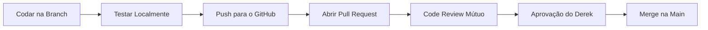

# 🌿 Guia de Git, Commits, Branches e Pull Requests

Este guia serve como a **Wiki Oficial de Governança** do projeto Feira & Cia. Todos os membros do time devem seguir estes padrões em suas tarefas diárias.

---

## 1. 🎋 Padrão de Nomenclatura de Branches

Nunca trabalhe ou faça commits diretamente na branch `main`. Toda funcionalidade ou correção deve nascer em uma branch própria a partir da `main` atualizada.

### Formato Obrigatório:
```bash
<tipo>/issue-<numero>-<descricao-curta-em-kebab-case>
```

### Prefixos permitidos:
* **`feat/`**: Nova funcionalidade ou recurso de tela/API.
  * *Exemplo*: `feat/issue-01-crud-usuarios`, `feat/issue-06-busca-produtos`
* **`fix/`**: Correção de bug em código já existente.
  * *Exemplo*: `fix/issue-08-sincronizacao-tarja`, `fix/issue-14-remocao-carrinho`
* **`refactor/`**: Melhoria interna de código sem alterar o comportamento externo.
  * *Exemplo*: `refactor/issue-00a-botoes-variantes`
* **`docs/`**: Alterações em documentação ou comentários.
* **`chore/`**: Tarefas de manutenção, dependências ou infraestrutura.

### Comandos Git para criar sua branch:
```bash
# 1. Garanta que está na main e atualizado
git checkout main
git pull origin main

# 2. Crie e troque para a sua nova branch
git checkout -b feat/issue-01-crud-usuarios
```

---

## 2. 📝 Padrão de Commits (Conventional Commits)

Utilizamos o padrão **Conventional Commits**, adotado por 90% das empresas de tecnologia. Cada commit deve ser atômico (uma mudança com sentido próprio) e escrito em letras minúsculas no imperativo.

### Formato:
```text
<tipo>(escopo-opcional): <mensagem curta e descritiva>
```

### Tipos mais comuns:
* **`feat`**: Adição de uma nova funcionalidade.
  * *Exemplo*: `feat(users): add user creation endpoint with bcrypt hashing`
  * *Exemplo*: `feat(ui): implement product chip component with category colors`
* **`fix`**: Correção de um erro ou bug.
  * *Exemplo*: `fix(floatbar): fix clear button not resetting item counter`
* **`refactor`**: Refatoração de código sem mudar a regra de negócio.
  * *Exemplo*: `refactor(auth): extract jwt verification to auth service`
* **`style`**: Formatação de código, lint, espaços em branco (sem afetar lógica).
* **`docs`**: Mudança em arquivos de documentação ou README.
* **`test`**: Adição ou ajuste de testes automatizados.
* **`chore`**: Atualização de pacotes npm, Dockerfile ou configurações.

---

## 3. 🚀 Ciclo de Vida de um Pull Request (Passo a Passo)



### Passo 1: Antes de abrir o PR (Checagem Local)
Antes de enviar o código, rode na raiz do projeto:
```bash
npm run build
```
Se compilar sem erros de TypeScript e sem erros no linter, sua branch está pronta!

### Passo 2: Enviar a branch para o GitHub
```bash
git push -u origin feat/issue-01-crud-usuarios
```

### Passo 3: Abrir o Pull Request
1. Acesse o repositório no GitHub: [derek-alves/lista-de-compras](https://github.com/derek-alves/lista-de-compras).
2. Clique no botão **"Compare & pull request"**.
3. Dê um título claro (ex: `feat(users): CRUD de usuários e hashing com bcrypt (#1)`).
4. O GitHub carregará automaticamente o nosso **PR Template**:
   * Preencha o número da issue que resolve.
   * Marque os checkboxes do que foi feito.
   * Cole evidências (print da tela ou print do Swagger funcionando).
   * Descreva o passo a passo de como o colega deve testar.

---

## 4. 🔍 Como Realizar um Code Review Construtivo

Revisar o código de um colega é uma das habilidades mais valorizadas em uma entrevista técnica.

### O que o revisor deve analisar:
1. **Funciona como esperado?** Puxe a branch na sua máquina e teste localmente.
2. **Legibilidade**: O código está limpo, bem nomeado e sem variáveis com nomes genéricos (`a`, `x`, `temp`)?
3. **Tipagem TypeScript**: O código respeita a tipagem estrita (sem uso de `any`)?
4. **Segurança**: Não há senhas, tokens ou dados sensíveis expostos em texto puro?

### Boas práticas de comunicação nos comentários:
* ✅ Seja gentil e específico: *"Excelente separação de componentes! O que acha de extrairmos essa função de cálculo para um arquivo utilitário para facilitar o reuso?"*
* ❌ Evite ordens secas: *"Tá errado, refaz."*
* Após revisar, selecione **"Approve"** para registrar sua aprovação oficial!

---

## 5. 🔄 Como Manter sua Branch Atualizada com a `main`

Se o seu colega mergeou um PR antes de você, atualize a sua branch para não ter conflitos:

```bash
# 1. Atualize a sua main local
git checkout main
git pull origin main

# 2. Volte para a sua branch e traga as novidades da main
git checkout feat/sua-feature
git merge main
```
Resolva eventuais conflitos no VS Code (se houver), teste a aplicação e dê `git push` novamente.

---

## 6. 🛑 Regra de Tamanho de PR: Limite Máximo de 50 Arquivos Alterados

Para garantir que o código seja revisado com qualidade e atenção aos detalhes, o repositório adota um **limite estrito de no máximo 50 arquivos alterados por Pull Request**.

### Por que PRs gigantes são proibidos?
1. **Fadiga de Revisão**: Revisar um PR com 80 ou 100 arquivos faz com que bugs graves passem despercebidos.
2. **Conflitos de Merge**: Quanto maior o PR, maior a chance de quebrar o trabalho do outro colega que está codando em paralelo.
3. **Padrão de Mercado**: Empresas de alta maturidade valorizam *Vertical Slices* (entregas pequenas, atômicas e funcionais).

> ⚠️ **Atenção**: Se um Pull Request alterar mais de 50 arquivos, o check automático de governança falhará e o botão de Merge ficará **bloqueado**. Caso sua tarefa envolva muitas mudanças, quebre-a em 2 PRs menores e envie sequencialmente!

---

## 7. 🧪 Estratégia Gradual de CI & Testes Automatizados

Para preparar você para o dia a dia de empresas de alto nível sem criar barreiras desnecessárias no começo, adotamos uma **Estratégia Gradual de Qualidade de Código**:

### Nível 1: Compilação e Tipagem Obrigatórias (Desde o Dia 1 - Bloqueante)
Em todo Pull Request, o GitHub verifica se o código compila perfeitamente:
* `npm run build` no backend (NestJS) e no frontend (React + Vite).
* Nenhum PR entra na `main` com erros de TypeScript (`tsc`), imports quebrados ou variáveis inexistentes.
* **Se o build quebrar, o merge fica bloqueado.**

### Nível 2: Testes Automatizados Graduais (`npm test`)
* **Fase 1 — Educativa (Milestones 0 a 2)**:
  * O objetivo aqui é aprender a sintaxe de testes (`describe`, `it`, `expect`, mocks) sem o estresse de travar a entrega.
  * Nas tarefas de Usuários (#9), Formulários (#10) e Autenticação (#11), você escreverá seus primeiros testes unitários com Jest e Vitest como ambiente de aprendizado.
  * O CI executa os testes de forma informativa, dando feedback amigável sem bloquear o merge.
* **Fase 2 — Missão Crítica (Milestones 3 e 4 - Bloqueante no CI)**:
  * A partir da finalização de compras (#21), o app passa a lidar com dinheiro, integridade financeira e transações no banco de dados.
  * A partir deste ponto, **100% dos testes automatizados tornam-se bloqueantes no CI**. Nenhum PR de checkout financeiro ou histórico é aceito se os testes de rollback e cálculos quebrarem.


