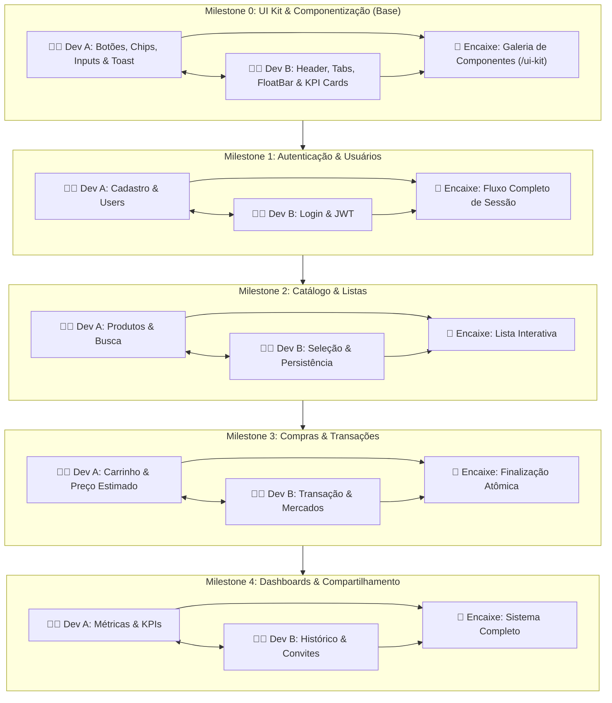

# 🧺 Plano de Engenharia e Mentoria: Projeto Feira & Cia (Full-Stack)

Este documento estabelece o plano diretor técnico, a governança de equipe e o **backlog executivo pareado** para capacitar dois desenvolvedores juniores em um ambiente de simulação real de empresa de tecnologia.

---

## 📌 Status Atual do Projeto (Entregas Realizadas)

As etapas fundamentais de infraestrutura, arquitetura e governança já foram **entregues e validadas**:

* ✅ **Monorepo TypeScript**: Workspaces `/apps/api` e `/apps/web` configurados.
* ✅ **Infraestrutura Docker**: PostgreSQL 16 pronto com `npm run docker:up` ou ambiente completo via `docker compose up --build`.
* ✅ **Backend Base (NestJS)**: Prisma ORM v6 integrado, Swagger ativo em `/api/docs`, CORS habilitado e pipes de validação globais.
* ✅ **Frontend Base (React Vite)**: Tailwind CSS v4, Google Fonts (Fraunces, DM Sans, Space Mono), tokens de cores temáticas, utilitários em `theme.ts` e tela de status operacional.
* ✅ **Governança Git Ativa**: Branch `main` protegida, `.github/CODEOWNERS` configurado (Derek como aprovador obrigatório), template de PR padronizado e repositório público no GitHub ([derek-alves/lista-de-compras](https://github.com/derek-alves/lista-de-compras)).

---

## 🎨 A Estratégia "Component-First": Por que criar o UI Kit Antes de Tudo?

Antes de mergulhar no backend e regras de negócio, a dupla passará pela **Milestone 0: Design System & UI Kit Reutilizável**.

### Por que essa abordagem é transformadora para um júnior?
1. **Evita JSX Espaguete**: Sem um kit pronto, juniores costumam recriar botões e inputs copiando e colando classes Tailwind em todas as páginas.
2. **Ensina os Fundamentos Mais Cobrados em Front-end**:
   * **Props Tipadas com TypeScript**: `interface ButtonProps extends React.ButtonHTMLAttributes<HTMLButtonElement>`.
   * **Variantes de Estilo e Estados**: Cores primárias, secundárias, ativo, desabilitado e estados de hover/focus.
   * **Composição de Componentes**: Uso de `children`, ícones via composição e slots.
3. **Showcase Visual Imediato**: Eles montam uma página de galeria (`/ui-kit`) onde você (Tech Lead) e eles conseguem visualizar e testar todos os componentes isolados antes de conectá-los com a API.

---

## 👥 Como a Dupla Trabalha: Trilhas Pareadas e Pontos de Encaixe

---

## 📋 Backlog Completo com Referências Diretas ao Protótipo Original

---

### 🎨 Milestone 0: Design System & UI Kit Reutilizável (Component-First)

Nesta fase inicial, os dois desenvolvedores extraem os componentes visuais diretamente do arquivo base [./lista-mercado.html](./lista-mercado.html) para componentes React reutilizáveis dentro de `apps/web/src/components/ui/`.

#### 🧑‍💻 Pacote Dev A — Componentes Atômicos, Inputs e Feedback

* **[ISSUE-00A] Componente `Button` com 4 Variantes de Mercado**
  * *O que fazer*: Criar botão reutilizável flexível com suporte a variantes (`primary`, `light`, `clear-link`, `danger-outline`), tamanhos e estado `disabled`.
  * *Referência no protótipo base*:
    * Variante `primary`: [CSS linhas 210-215](./lista-mercado.html#L210-L215)
    * Variante `light` (fundo creme, texto vermelho): [CSS linhas 145-148](./lista-mercado.html#L145-L148) | [HTML linha 313](./lista-mercado.html#L313)
    * Variante `clear-link` (sem fundo, sublinhado): [CSS linhas 149-152](./lista-mercado.html#L149-L152) | [HTML linha 310](./lista-mercado.html#L310)
    * Variante `danger-outline` (borda vermelha): [CSS linhas 256-258](./lista-mercado.html#L256-L258) | [JS linha 621](./lista-mercado.html#L621)
  * *Critérios de Aceite*: Componente aceita todas as props nativas via TypeScript (`React.ButtonHTMLAttributes<HTMLButtonElement>`) e suporta `forwardRef`.

* **[ISSUE-00B] Componentes de Entrada: `SearchBar` e `DateRowInput`**
  * *O que fazer*:
    * `SearchBar`: Campo com fundo marfim (`#fffdf7`), borda suave de 1px e cantos arredondados (10px).
    * `DateRowInput`: Card com label em caixa alta e input `type="date"` estilizado em fonte monoespaçada.
  * *Referência no protótipo base*:
    * `SearchBar`: [CSS linhas 84-94](./lista-mercado.html#L84-L94) | [HTML linhas 283-285](./lista-mercado.html#L283-L285)
    * `DateRowInput`: [CSS linhas 155-164](./lista-mercado.html#L155-L164) | [HTML linhas 291-294](./lista-mercado.html#L291-L294)

* **[ISSUE-00C] Componentes de Seleção: `ProductChip` e `CategoryDot`**
  * *O que fazer*: Pílula arredondada com bolinha colorida da categoria (`CategoryDot`), efeito tátil de clique (`active:scale-95`) e alternância entre estado padrão e selecionado (fundo preenchido com a cor da categoria e texto creme).
  * *Referência no protótipo base*: [CSS linhas 109-131](./lista-mercado.html#L109-L131) | [JS linhas 400-406](./lista-mercado.html#L400-L406)

* **[ISSUE-00D] Feedback e Mensagens: `Toast` e `EmptyState`**
  * *O que fazer*:
    * `Toast`: Notificação flutuante inferior em fundo escuro (`--ink`) e texto claro com transição de subida (`translateY`) e auto-dismiss.
    * `EmptyState`: Mensagem centralizada e tipografada para estados de lista vazia.
  * *Referência no protótipo base*:
    * `Toast`: [CSS linhas 260-265](./lista-mercado.html#L260-L265) | [HTML linha 316](./lista-mercado.html#L316) | [JS linhas 374-379](./lista-mercado.html#L374-L379)
    * `EmptyState`: [CSS linhas 165-168](./lista-mercado.html#L165-L168) | [HTML linha 451](./lista-mercado.html#L451)

---

#### 👩‍💻 Pacote Dev B — Estrutura de Layout, Barras e Dashboards

* **[ISSUE-00E] Estrutura e Navegação: `AppHeader`, `AppContainer` e `TabsNav`**
  * *O que fazer*:
    * `AppHeader`: Barra de topo fixa (`sticky top: 0`) com título em fonte `Fraunces` e slogan temático.
    * `TabsNav`: Navegador por abas (Lista, Compra, Painel) com borda superior arredondada (`rounded-t-lg`) e transição de estado ativo.
    * `AppContainer`: Container com largura máxima de 520px centralizado para mobile.
  * *Referência no protótipo base*:
    * `AppHeader`: [CSS linhas 40-58](./lista-mercado.html#L40-L58) | [HTML linhas 270-273](./lista-mercado.html#L270-L273)
    * `TabsNav`: [CSS linhas 59-77](./lista-mercado.html#L59-L77) | [HTML linhas 273-277](./lista-mercado.html#L273-L277) | [JS linhas 643-656](./lista-mercado.html#L643-L656)

* **[ISSUE-00F] Cabeçalho de Categoria: `CategoryHeader`**
  * *O que fazer*: Título da seção com barra lateral esquerda de 5px (`border-l-[5px]`) tingida na cor da categoria, ícone emoji e nome em fonte *Fraunces*.
  * *Referência no protótipo base*: [CSS linhas 95-108](./lista-mercado.html#L95-L108) | [JS linhas 389-395](./lista-mercado.html#L389-L395)

* **[ISSUE-00G] Barras Flutuantes: `FloatBar` e `ReceiptBar`**
  * *O que fazer*:
    * `FloatBar`: Barra fixa inferior vermelha com contagem de itens, link de limpar e botão de iniciar compra.
    * `ReceiptBar`: Barra estilo nota fiscal com acabamento serrilhado no topo (`.receipt-torn`), exibição grande do total e botão de finalizar compra.
  * *Referência no protótipo base*:
    * `FloatBar`: [CSS linhas 132-152](./lista-mercado.html#L132-L152) | [HTML linhas 308-315](./lista-mercado.html#L308-L315) | [JS linhas 423-430](./lista-mercado.html#L423-L430)
    * `ReceiptBar`: [CSS linhas 190-216](./lista-mercado.html#L190-L216) | [JS linhas 518-532](./lista-mercado.html#L518-L532)

* **[ISSUE-00H] Dashboards: `KpiCard`, `CategoryProgressBar` e `PurchaseHistoryCard`**
  * *O que fazer*:
    * `KpiCard`: Card com label em caixa alta e valor monetário/contagem em `Space Mono`.
    * `CategoryProgressBar`: Barra proporcional horizontal com nome da categoria e valor em R$.
    * `PurchaseHistoryCard`: Card sanfonado (`
 / 
`) com data no padrão brasileiro, lista de itens pontilhada e botão de exclusão.
  * *Referência no protótipo base*:
    * `KpiCard`: [CSS linhas 218-225](./lista-mercado.html#L218-L225) | [JS linhas 574-592](./lista-mercado.html#L574-L592)
    * `CategoryProgressBar`: [CSS linhas 230-237](./lista-mercado.html#L230-L237) | [JS linhas 593-607](./lista-mercado.html#L593-L607)
    * `PurchaseHistoryCard`: [CSS linhas 238-259](./lista-mercado.html#L238-L259) | [JS linhas 609-633](./lista-mercado.html#L609-L633)

> 🔗 **Ponto de Integração da Milestone 0 (Showcase)**:
> Dev A e Dev B criam a página `/ui-kit` (Galeria de Componentes) onde colocam todos os botões, chips, barras e inputs lado a lado funcionando. Derek revisa a qualidade e o acabamento dos componentes antes de avançarem para o backend.

---

### 🟢 Milestone 1: Autenticação e Gestão de Usuários

#### 🧑‍💻 Pacote Dev A — Cadastro e Gestão de Usuários
* **[ISSUE-01] Backend: Modelagem e CRUD de Usuários**
  * *Camada*: NestJS (`UsersModule`) + Prisma.
  * *O que fazer*: Criar endpoint `POST /users` com validação de email (`@IsEmail()`) e hashing de senha seguro usando `bcrypt` (10 rounds).
  * *Contrato de API*: Recebe `{ name, email, password }` e devolve `{ id, name, email, createdAt }` (sem a senha).
* **[ISSUE-02] Frontend: Tela e Formulário de Cadastro**
  * *Camada*: React + Hook Form + Zod.
  * *O que fazer*: Criar a tela de Registro utilizando os componentes `Button` e `Input` criados na Milestone 0, com validação em tempo real e feedback de erro amigável.
  * *Conexão direta*: Envia os dados para o endpoint `POST /users` criado na ISSUE-01.

---

#### 👩‍💻 Pacote Dev B — Login, JWT e Sessão
* **[ISSUE-03] Backend: Autenticação JWT, Refresh Token e Guards**
  * *Camada*: NestJS (`AuthModule`) + Passport JWT.
  * *O que fazer*: Criar `POST /auth/login` (gera Access Token de 15 min + Refresh Token em Cookie HttpOnly), `POST /auth/refresh`, decorator `@CurrentUser()` e `JwtAuthGuard`.
  * *Contrato de API*: Recebe `{ email, password }` e devolve `{ accessToken, user }`.
* **[ISSUE-04] Frontend: Tela de Login e Contexto de Autenticação**
  * *Camada*: React Context (`AuthContext`) + Hook Form + Zod.
  * *O que fazer*: Criar a tela de Login utilizando o `Button` e `Input` da Milestone 0, salvar a sessão no `AuthContext` e proteger as rotas.
  * *Conexão direta*: Consome `POST /auth/login` e armazena os dados da sessão.

> 🔗 **Ponto de Integração da Milestone 1**: 
> Usuário se cadastra pela tela do Dev A, é redirecionado para a tela do Dev B, faz login com sucesso e entra na aplicação autenticada.

---

### 🟡 Milestone 2: Catálogo de Produtos e Gestão de Listas

#### 🧑‍💻 Pacote Dev A — Catálogo e Busca de Produtos
* **[ISSUE-05] Backend: Seed do Banco com as 10 Categorias e Produtos**
  * *Camada*: Prisma (`prisma/seed.ts`).
  * *O que fazer*: Script para popular o banco com as 10 categorias padrão com cores temáticas e produtos reais do protótipo base ([linhas 323-334](./lista-mercado.html#L323-L334)).
* **[ISSUE-06] Backend: API de Listagem e Criação de Produtos**
  * *Camada*: NestJS (`ProductsModule`).
  * *O que fazer*: Criar `GET /products` com busca por texto (`search`) e categoria (`categoryId`), além de `POST /products` para novos produtos criados pelo usuário.
* **[ISSUE-07] Frontend: Aba Lista com os Componentes Reutilizáveis**
  * *Camada*: React + Tailwind.
  * *O que fazer*: Montar a aba Lista integrando os componentes `SearchBar` e `ProductChip` da Milestone 0, renderizando os produtos da API com busca em tempo real.

---

#### 👩‍💻 Pacote Dev B — Seleção de Itens e Persistência da Lista
* **[ISSUE-08] Frontend: ListContext e Conexão com a FloatBar**
  * *Camada*: React Context (`ListContext`).
  * *O que fazer*: Conectar o `ListContext` aos chips do Dev A e à `FloatBar` da Milestone 0. Corrigir o bug do protótipo: o botão "Limpar" zera os chips e oculta a barra sem deixar lixo de estado ([referência de bug: linhas 432-437](./lista-mercado.html#L432-L437)).
* **[ISSUE-09] Full-stack: Persistência da Lista Ativa no Backend**
  * *Camada*: NestJS (`ListsModule`) + React.
  * *O que fazer*: Endpoints `GET /lists/active` e `PUT /lists/active` para salvar a lista em andamento do usuário no PostgreSQL.
  * *Conexão direta*: O `ListContext` sincroniza com o backend via debounce para não perder a seleção ao fechar o navegador.

> 🔗 **Ponto de Integração da Milestone 2**:
> Os produtos que o Dev A exibe com o `ProductChip` reagem aos cliques controlados pelo `ListContext` do Dev B, atualizando a `FloatBar` e salvando a seleção do usuário no banco.

---

### 🟠 Milestone 3: Execução de Compras e Regras de Negócio

#### 🧑‍💻 Pacote Dev A — Experiência do Carrinho e Inteligência de Preço
* **[ISSUE-10] Frontend: Aba de Compra (Carrinho em Tempo Real)**
  * *Camada*: React.
  * *O que fazer*: Montar a aba *Compra* exibindo apenas os itens marcados na aba anterior, utilizando o card de produto do carrinho (`.row-item`: [linhas 169-189](./lista-mercado.html#L169-L189)). Preencher quantidade default como `1` e calcular subtotais instantaneamente.
* **[ISSUE-11] Full-stack: Preenchimento com o Último Preço Pago**
  * *Camada*: NestJS (`GET /products/:id/last-price`) + React.
  * *O que fazer*: Criar endpoint que busca no histórico de compras o valor pago anteriormente pelo usuário naquele item e pré-preenche o preço estimado no carrinho.

---

#### 👩‍💻 Pacote Dev B — Supermercados e Finalização Atômica
* **[ISSUE-12] Full-stack: Cadastro e Seleção de Supermercados**
  * *Camada*: NestJS + Prisma (`Market`) + React.
  * *O que fazer*: Criar endpoints para listar e registrar mercados onde as compras foram realizadas (ex: "Carrefour", "Assaí", "Feira da Praça").
* **[ISSUE-13] Backend: Finalização de Compra com Transação Atômica**
  * *Camada*: NestJS (`POST /purchases`) + Prisma `$transaction`.
  * *O que fazer*: Endpoint que valida subtotais no backend, cria a transação em `PurchaseHistory`, adiciona os `PurchaseItem` e esvazia a lista ativa do usuário com garantia de *rollback* em caso de erro ([lógica original: linhas 534-570](./lista-mercado.html#L534-L570)).
* **[ISSUE-14] Frontend: Sincronização Cruzada de Itens (Correção de Bug)**
  * *Camada*: React.
  * *O que fazer*: Conectar a remoção de itens na aba Compra com o desmarque do chip na aba Lista e a atualização do total na `ReceiptBar` ([bug original: linhas 477-486](./lista-mercado.html#L477-L486)).

> 🔗 **Ponto de Integração da Milestone 3**:
> O carrinho montado pelo Dev A consome o cadastro de mercados e dispara o endpoint de finalização atômica criado pelo Dev B, registrando a compra com segurança no banco.

---

### 🟣 Milestone 4: Dashboards, Histórico e Compartilhamento

#### 🧑‍💻 Pacote Dev A — Dashboard Financeiro e Estatísticas
* **[ISSUE-15] Backend: API de Agregações Financeiras e Gastos por Categoria**
  * *Camada*: NestJS (`GET /dashboard/summary`) + SQL/Prisma.
  * *O que fazer*: Calcular total gasto, ticket médio por compra, quantidade de compras e gastos agrupados por categoria com filtro de data ([cálculos originais: linhas 574-586](./lista-mercado.html#L574-L586)).
* **[ISSUE-16] Frontend: Painel de Métricas Conectando os KpiCards**
  * *Camada*: React.
  * *O que fazer*: Construir a aba *Painel* consumindo o endpoint do resumo: conectar os `KpiCard` e as `CategoryProgressBar` criados na Milestone 0 com os dados reais da API ([layout original: linhas 587-606](./lista-mercado.html#L587-L606)).

---

#### 👩‍💻 Pacote Dev B — Histórico de Compras e Compartilhamento
* **[ISSUE-17] Full-stack: Histórico de Compras com Edição de Data**
  * *Camada*: NestJS + React.
  * *O que fazer*: Listagem sanfonada (accordion) de compras passadas com detalhe de itens, botão de exclusão com modal de confirmação e possibilidade de alterar a data pós-finalizada ([render original: linhas 609-633](./lista-mercado.html#L609-L633)).
* **[ISSUE-18] Full-stack: Compartilhamento de Lista entre Usuários**
  * *Camada*: NestJS + React.
  * *O que fazer*: Sistema de convite por email para que dois usuários visualizem e gerenciem a mesma lista de feira simultaneamente.

> 🔗 **Ponto de Integração da Milestone 4**:
> Todas as compras salvas na Milestone 3 alimentam o Dashboard e os gráficos do Dev A e o Histórico com filtros do Dev B. O projeto atinge 100% de maturidade comercial!
