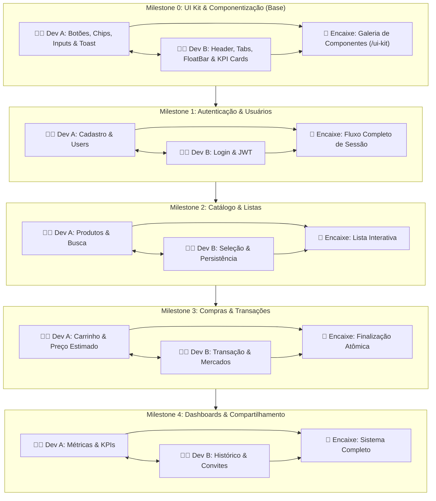

# 🧺 Plano de Engenharia e Mentoria: Projeto Feira & Cia (Full-Stack)

Este documento estabelece o plano diretor técnico, a governança de equipe e o **backlog executivo detalhado com subtarefas técnicas (checklists)** para capacitar dois desenvolvedores juniores em um ambiente de simulação real de empresa de tecnologia.

---

## 📌 Status Atual do Projeto (Entregas Realizadas)

As etapas fundamentais de infraestrutura, arquitetura e governança já foram **entregues e validadas**:

* ✅ **Monorepo TypeScript**: Workspaces `/apps/api` e `/apps/web` configurados.
* ✅ **Infraestrutura Docker**: PostgreSQL 16 pronto com `npm run docker:up` ou ambiente completo via `docker compose up --build`.
* ✅ **Backend Base (NestJS)**: Prisma ORM v6 integrado, Swagger ativo em `/api/docs`, CORS habilitado e pipes de validação globais.
* ✅ **Frontend Base (React Vite)**: Tailwind CSS v4, Google Fonts (Fraunces, DM Sans, Space Mono), tokens de cores temáticas, utilitários em `theme.ts` e tela de status operacional.
* ✅ **Governança Git Ativa**: Branch `main` protegida, `.github/CODEOWNERS` configurado (Derek como aprovador obrigatório), template de PR padronizado e repositório público no GitHub ([derek-alves/lista-de-compras](https://github.com/derek-alves/lista-de-compras)).

---

## 🎨 A Estratégia "Component-First": Por que criar o UI Kit Antes de Tudo?

Antes de mergulhar no backend e regras de negócio, a dupla passará pela **Milestone 0: Design System & UI Kit Reutilizável**.

### Por que essa abordagem é transformadora para um júnior?
1. **Evita JSX Espaguete**: Sem um kit pronto, juniores costumam recriar botões e inputs copiando e colando classes Tailwind em todas as páginas.
2. **Ensina os Fundamentos Mais Cobrados em Front-end**:
   * **Props Tipadas com TypeScript**: `interface ButtonProps extends React.ButtonHTMLAttributes<HTMLButtonElement>`.
   * **Variantes de Estilo e Estados**: Cores primárias, secundárias, ativo, desabilitado e estados de hover/focus.
   * **Composição de Componentes**: Uso de `children`, ícones via composição e slots.
3. **Showcase Visual Imediato**: Eles montam uma página de galeria (`/ui-kit`) onde você (Tech Lead) e eles conseguem visualizar e testar todos os componentes isolados antes de conectá-los com a API.

---

## 👥 Como a Dupla Trabalha: Trilhas Pareadas e Pontos de Encaixe

---

## 📋 Backlog com Subtarefas Técnicas Passo a Passo

---

### 🎨 Milestone 0: Design System & UI Kit Reutilizável (Component-First)

Nesta fase inicial, os dois desenvolvedores extraem os componentes visuais diretamente do arquivo base [./lista-mercado.html](./lista-mercado.html) para componentes React reutilizáveis dentro de `apps/web/src/components/ui/`.

#### 🧑‍💻 Pacote Dev A — Componentes Atômicos, Inputs e Feedback

* **[ISSUE-00A] Componente `Button` com 4 Variantes de Mercado**
  * *Local de criação*: `apps/web/src/components/ui/Button.tsx`
  * *Subtarefas Técnicas*:
    - [ ] Criar interface `ButtonProps` estendendo `React.ButtonHTMLAttributes<HTMLButtonElement>` com a prop `variant?: 'primary' | 'light' | 'clear-link' | 'danger-outline'` e `size?: 'sm' | 'md' | 'lg'`.
    - [ ] Implementar variantes de estilo via Tailwind:
      * `primary`: fundo `--accent` (`bg-accent`), texto creme, cantos arredondados (`rounded-lg`), padding e transição de clique ([CSS linhas 210-215](./lista-mercado.html#L210-L215)).
      * `light`: fundo creme, texto `--accent`, cantos arredondados (`rounded-lg`) ([CSS linhas 145-148](./lista-mercado.html#L145-L148) | [HTML linha 313](./lista-mercado.html#L313)).
      * `clear-link`: fundo transparente, texto pêssego/suave, sublinhado ([CSS linhas 149-152](./lista-mercado.html#L149-L152) | [HTML linha 310](./lista-mercado.html#L310)).
      * `danger-outline`: borda 1px `--accent`, texto `--accent`, fundo transparente ([CSS linhas 256-258](./lista-mercado.html#L256-L258) | [JS linha 621](./lista-mercado.html#L621)).
    - [ ] Adicionar suporte ao estado `disabled` com redução de opacidade (`disabled:opacity-40 disabled:cursor-not-allowed`).
    - [ ] Exportar o componente utilizando `React.forwardRef`.

* **[ISSUE-00B] Componentes de Entrada: `SearchBar` e `DateRowInput`**
  * *Local de criação*: `apps/web/src/components/ui/SearchBar.tsx` e `apps/web/src/components/ui/DateRowInput.tsx`
  * *Subtarefas Técnicas*:
    - [ ] Criar `SearchBar`:
      - [ ] Campo com fundo marfim (`bg-[#fffdf7]`), borda 1px `border-line`, cantos `rounded-xl` (10px) e texto `text-ink` ([CSS linhas 84-94](./lista-mercado.html#L84-L94) | [HTML linhas 283-285](./lista-mercado.html#L283-L285)).
      - [ ] Adicionar ícone de lupa da biblioteca `lucide-react` à esquerda e botão de limpar texto à direita (se houver texto digitado).
      - [ ] Aceitar prop `onSearchChange: (value: string) => void`.
    - [ ] Criar `DateRowInput`:
      - [ ] Card flex horizontal com fundo `#fffdf7`, borda suave e cantos arredondados ([CSS linhas 155-164](./lista-mercado.html#L155-L164) | [HTML linhas 291-294](./lista-mercado.html#L291-L294)).
      - [ ] Label em caixa alta "DATA DA COMPRA" e input `type="date"` sem borda nativa, formatado em `font-mono`.
      - [ ] Valor inicial preenchido automaticamente com a data de hoje (`new Date().toISOString().slice(0,10)`).

* **[ISSUE-00C] Componentes de Seleção: `ProductChip` e `CategoryDot`**
  * *Local de criação*: `apps/web/src/components/ui/ProductChip.tsx`
  * *Subtarefas Técnicas*:
    - [ ] Criar componente `CategoryDot`: bolinha colorida redonda de 6px (`w-1.5 h-1.5 rounded-full`) tingida com a cor da categoria recebida via prop ([CSS linha 129](./lista-mercado.html#L129)).
    - [ ] Criar componente `ProductChip`:
      - [ ] Estilo base: pílula arredondada (`rounded-full`), borda 1.5px `border-line`, fundo marfim `#fffdf7`, padding horizontal e efeito tátil de clique (`active:scale-95`) ([CSS linhas 109-131](./lista-mercado.html#L109-L131)).
      - [ ] Estado `selected`: quando `isSelected === true`, preencher o fundo com a cor da categoria, mudar o texto para creme `#fff9ef`, aumentar o peso da fonte para negrito e mudar a cor do dot interno para branco ([JS linhas 400-406](./lista-mercado.html#L400-L406)).
      - [ ] Aceitar props: `name: string`, `categoryColor: string`, `isSelected: boolean`, `onClick: () => void`.

* **[ISSUE-00D] Feedback e Mensagens: `Toast` e `EmptyState`**
  * *Local de criação*: `apps/web/src/components/ui/Toast.tsx` e `apps/web/src/components/ui/EmptyState.tsx`
  * *Subtarefas Técnicas*:
    - [ ] Criar `Toast`:
      - [ ] Notificação flutuante fixa na parte inferior centralizada (`fixed left-1/2 -translate-x-1/2 bottom-24`) ([CSS linhas 260-265](./lista-mercado.html#L260-L265)).
      - [ ] Fundo escuro `--ink`, texto creme `--paper`, cantos `rounded-lg`, z-index 50 e transição suave de opacidade e subida (`translateY`).
      - [ ] Temporizador automático de 2 segundos para auto-dismiss ([JS linhas 374-379](./lista-mercado.html#L374-L379)).
    - [ ] Criar `EmptyState`:
      - [ ] Container com texto centralizado, cor suave `text-ink-soft`, padding generoso (40px) e entrelinha agradável ([CSS linhas 165-168](./lista-mercado.html#L165-L168) | [HTML linha 451](./lista-mercado.html#L451)).
      - [ ] Suportar prop `message: React.ReactNode` ou `children`.

---

#### 👩‍💻 Pacote Dev B — Estrutura de Layout, Barras e Dashboards

* **[ISSUE-00E] Estrutura e Navegação: `AppHeader`, `AppContainer` e `TabsNav`**
  * *Local de criação*: `apps/web/src/components/ui/AppHeader.tsx` e `apps/web/src/components/ui/TabsNav.tsx`
  * *Subtarefas Técnicas*:
    - [ ] Criar `AppContainer`: container que limita a largura a 520px centralizado na tela (`max-w-[520px] mx-auto min-h-screen flex flex-col pb-24`) ([CSS linha 38](./lista-mercado.html#L38)).
    - [ ] Criar `AppHeader`: barra fixa no topo (`sticky top-0 z-20`), fundo verde `--awning`, título em fonte `font-serif` "🧺 Feira & Cia" e slogan em itálico "nunca mais esquece nada no mercado" ([CSS linhas 40-58](./lista-mercado.html#L40-L58) | [HTML linhas 270-273](./lista-mercado.html#L270-L273)).
    - [ ] Criar `TabsNav`:
      - [ ] Menu flex horizontal com 3 abas: "Lista", "Compra", "Painel" ([HTML linhas 273-277](./lista-mercado.html#L273-L277)).
      - [ ] Borda superior arredondada (`rounded-t-lg`), fundo `--awning-light` com opacidade reduzida nas abas inativas.
      - [ ] Aba ativa: fundo `--paper`, cor do texto `--awning` e opacidade total ([CSS linhas 59-77](./lista-mercado.html#L59-L77) | [JS linhas 643-656](./lista-mercado.html#L643-L656)).
      - [ ] Disparar callback `activeTab: string` e `onTabChange: (tab: string) => void`.

* **[ISSUE-00F] Cabeçalho de Categoria: `CategoryHeader`**
  * *Local de criação*: `apps/web/src/components/ui/CategoryHeader.tsx`
  * *Subtarefas Técnicas*:
    - [ ] Criar cabeçalho de seção flex com ícone emoji e título em fonte `font-serif` ([CSS linhas 95-108](./lista-mercado.html#L95-L108) | [JS linhas 389-395](./lista-mercado.html#L389-L395)).
    - [ ] Adicionar barra vertical lateral esquerda de 5px (`border-l-[5px]`) tingida dinamicamente com a cor da categoria recebida via prop (`colorVar`).
    - [ ] Aceitar props: `name: string`, `icon: string`, `colorVar: string`.

* **[ISSUE-00G] Barras Flutuantes: `FloatBar` e `ReceiptBar`**
  * *Local de criação*: `apps/web/src/components/ui/FloatBar.tsx` e `apps/web/src/components/ui/ReceiptBar.tsx`
  * *Subtarefas Técnicas*:
    - [ ] Criar `FloatBar`:
      - [ ] Barra fixa no rodapé (`fixed bottom-0 left-0 right-0 max-w-[520px] mx-auto z-30`), fundo vermelho `--accent`, texto creme e sombra forte ([CSS linhas 132-152](./lista-mercado.html#L132-L152)).
      - [ ] Lado esquerdo: botão de "limpar" (`clear-link`) + contador textual de itens selecionados.
      - [ ] Lado direito: botão claro "Iniciar compra →" (`Button variant="light"`).
      - [ ] Esconder a barra automaticamente se o contador de itens for igual a 0.
    - [ ] Criar `ReceiptBar`:
      - [ ] Barra fixa no rodapé em fundo verde escuro `--awning`, z-index 30 e acabamento serrilhado no topo via classe `.receipt-torn` ([CSS linhas 190-216](./lista-mercado.html#L190-L216)).
      - [ ] Linha superior: texto em caixa alta "TOTAL DA COMPRA" e valor monetário formatado grande em `font-mono` (`text-2xl font-bold`).
      - [ ] Botão inferior de largura total (100%) "Finalizar compra" em vermelho `--accent`, desabilitado caso o total seja zero ([JS linhas 518-532](./lista-mercado.html#L518-L532)).

* **[ISSUE-00H] Dashboards: `KpiCard`, `CategoryProgressBar` e `PurchaseHistoryCard`**
  * *Local de criação*: `apps/web/src/components/ui/KpiCard.tsx`, `CategoryProgressBar.tsx` e `PurchaseHistoryCard.tsx`
  * *Subtarefas Técnicas*:
    - [ ] Criar `KpiCard`:
      - [ ] Card com fundo `#fffdf7`, borda `border-line`, cantos arredondados (10px) e padding ([CSS linhas 218-225](./lista-mercado.html#L218-L225)).
      - [ ] Label em caixa alta suave `text-[11px] text-ink-soft` e valor numérico em `font-mono text-xl font-bold text-awning`.
    - [ ] Criar `CategoryProgressBar`:
      - [ ] Linha flex com bolinha colorida, nome da categoria e valor em R$ monoespaçado ([CSS linhas 230-237](./lista-mercado.html#L230-L237)).
      - [ ] Barra de trilha com fundo `--paper-dark`, altura de 9px e preenchimento interno com largura percentual proporcional (`style={{ width: `${percent}%`, backgroundColor: color }}`).
    - [ ] Criar `PurchaseHistoryCard`:
      - [ ] Card sanfonado usando `
` e `
` nativos ou estado React ([CSS linhas 238-259](./lista-mercado.html#L238-L259)).
      - [ ] Cabeçalho: data formatada (pt-BR), contagem de itens e valor total em vermelho `--accent`.
      - [ ] Conteúdo expandido: lista pontilhada de itens comprados (`nome × qtd` à esquerda e `subtotal` à direita) + botão de exclusão (`Button variant="danger-outline"`).

> 🔗 **Ponto de Integração da Milestone 0 (Showcase)**:
> Dev A e Dev B criam a página `apps/web/src/pages/UiKitShowcase.tsx` acessível via rota `/ui-kit` onde renderizam todos os 14 componentes lado a lado funcionando. Derek revisa e dá o primeiro Code Review antes de abrirem as tarefas de backend!

---

### 🟢 Milestone 1: Autenticação e Gestão de Usuários

#### 🧑‍💻 Pacote Dev A — Cadastro e Gestão de Usuários

* **[ISSUE-01] Backend: Modelagem e CRUD de Usuários com Bcrypt**
  * *Camada*: NestJS (`UsersModule`) + Prisma
  * *Subtarefas Técnicas*:
    - [ ] Instalar o pacote de hash `bcrypt` e suas tipagens: `npm install bcrypt && npm install -D @types/bcrypt` em `apps/api`.
    - [ ] Criar o DTO `CreateUserDto` em `apps/api/src/users/dto/create-user.dto.ts` com validações:
      * `@IsString() @IsNotEmpty()` para o nome.
      * `@IsEmail()` para o email.
      * `@MinLength(6)` para a senha.
    - [ ] Implementar o `UsersService`:
      * Método `create`: verificar se o email já está cadastrado (`prisma.user.findUnique`). Se existir, lançar `ConflictException('Email já cadastrado')`.
      * Gerar salt e criptografar a senha com `await bcrypt.hash(password, 10)`.
      * Salvar o usuário no banco usando `prisma.user.create`.
      * Remover o campo `passwordHash` do objeto retornado.
    - [ ] Criar o `UsersController` com endpoint `@Post()` mapeado para `POST /api/users`.
    - [ ] Adicionar documentação OpenAPI com `@ApiTags('Users')`, `@ApiOperation` e `@ApiResponse`.
    - [ ] Testar no Swagger (`http://localhost:3000/api/docs`) o cadastro com sucesso e o erro de email duplicado.

* **[ISSUE-02] Frontend: Tela e Formulário de Cadastro com Zod**
  * *Camada*: React + React Hook Form + Zod
  * *Subtarefas Técnicas*:
    - [ ] Instalar as bibliotecas no front: `npm install react-hook-form @hookform/resolvers zod` em `apps/web`.
    - [ ] Criar o schema de validação `registerSchema` em `apps/web/src/schemas/auth.schema.ts`:
      * `name`: mínimo 2 caracteres.
      * `email`: formato de email válido.
      * `password`: mínimo 6 caracteres.
      * `confirmPassword`: validar igualdade com `password` via `.refine()`.
    - [ ] Criar a página `RegisterPage.tsx` utilizando os componentes `Input` e `Button` da Milestone 0.
    - [ ] Integrar com o endpoint `POST /api/users` utilizando o cliente Axios (`api.post('/users', data)`).
    - [ ] Exibir mensagens de erro abaixo de cada campo em tempo real.
    - [ ] Em caso de sucesso, disparar o `Toast` ("Conta criada com sucesso!") e redirecionar para a tela de login.

---

#### 👩‍💻 Pacote Dev B — Login, JWT e Sessão

* **[ISSUE-03] Backend: Autenticação JWT, Refresh Token e Guards**
  * *Camada*: NestJS (`AuthModule`) + Passport JWT
  * *Subtarefas Técnicas*:
    - [ ] Instalar dependências de autenticação em `apps/api`: `npm install @nestjs/jwt @nestjs/passport passport passport-jwt cookie-parser && npm install -D @types/passport-jwt @types/cookie-parser`.
    - [ ] Criar `AuthService`:
      * Método `validateUser`: buscar o usuário pelo email e validar a senha com `bcrypt.compare`.
      * Método `login`: gerar `accessToken` (expira em 15 minutos) assinado com `JWT_SECRET` e `refreshToken` (expira em 7 dias) assinado com `JWT_REFRESH_SECRET`.
    - [ ] Criar `AuthController`:
      * Endpoint `POST /api/auth/login`: recebe credenciais e anexa o `refreshToken` em um Cookie `HttpOnly`, `SameSite: Lax`, retornando o `accessToken` e os dados públicos do usuário no corpo.
      * Endpoint `POST /api/auth/refresh`: lê o cookie seguro, valida o refresh token e emite um novo access token.
      * Endpoint `POST /api/auth/logout`: limpa o cookie do refresh token.
    - [ ] Criar a estratégia `JwtStrategy` e o Guard `JwtAuthGuard` em `apps/api/src/auth/guards/jwt-auth.guard.ts`.
    - [ ] Criar o decorator `@CurrentUser()` para extrair os dados do usuário autenticado a partir do `request.user`.

* **[ISSUE-04] Frontend: Tela de Login e Contexto de Autenticação (`AuthContext`)**
  * *Camada*: React Context (`AuthContext`) + Hook Form + Zod
  * *Subtarefas Técnicas*:
    - [ ] Criar o schema de validação `loginSchema` em `apps/web/src/schemas/auth.schema.ts` (email e senha obrigatórios).
    - [ ] Criar o `AuthContext` em `apps/web/src/contexts/AuthContext.tsx`:
      * Estado `user: User | null`, `isAuthenticated: boolean`, `isLoading: boolean`.
      * Métodos: `signIn(credentials)`, `signOut()`.
      * Salvar o `accessToken` em memória (ou header padrão do Axios) para chamadas subsequentes.
    - [ ] Criar o componente `LoginPage.tsx` utilizando os componentes `Input` e `Button` da Milestone 0.
    - [ ] Criar um componente wrapper `PrivateRoute` que redireciona usuários não autenticados para `/login`.

> 🔗 **Ponto de Integração da Milestone 1**: 
> Usuário se cadastra pela tela do Dev A, é redirecionado para a tela do Dev B, faz login com sucesso e entra na aplicação autenticada.

---

### 🟡 Milestone 2: Catálogo de Produtos e Gestão de Listas

#### 🧑‍💻 Pacote Dev A — Catálogo e Busca de Produtos

* **[ISSUE-05] Backend: Seed do Banco com as 10 Categorias e Produtos**
  * *Camada*: Prisma (`prisma/seed.ts`)
  * *Subtarefas Técnicas*:
    - [ ] Criar o arquivo `apps/api/prisma/seed.ts`.
    - [ ] Extrair os dados das 10 categorias e os mais de 80 produtos pré-existentes do protótipo base ([linhas 323-334](./lista-mercado.html#L323-L334)).
    - [ ] Escrever rotina idempotente usando `prisma.category.upsert` e `prisma.product.upsert` (garantindo que rodar o seed múltiplas vezes não duplique registros).
    - [ ] Adicionar o script `"prisma": { "seed": "ts-node prisma/seed.ts" }` no `package.json` da API.
    - [ ] Executar o comando `npx prisma db seed` e validar a população das tabelas através do Prisma Studio (`npm run prisma:studio`).

* **[ISSUE-06] Backend: API de Listagem e Criação de Produtos**
  * *Camada*: NestJS (`ProductsModule`)
  * *Subtarefas Técnicas*:
    - [ ] Gerar o módulo: `nest g module products && nest g controller products && nest g service products` em `apps/api`.
    - [ ] Implementar endpoint `GET /api/products`:
      * Aceitar query parameters opcionais: `?search=arroz&categoryId=uuid`.
      * Fazer busca case-insensitive no Prisma com `mode: 'insensitive'`.
      * Trazer os produtos agrupados por categoria ou com a relação de categoria embutida (`include: { category: true }`).
    - [ ] Implementar endpoint `POST /api/products` (protegido por `JwtAuthGuard`):
      * DTO `CreateProductDto`: `name: string` e `categoryId: string`.
      * Salvar o produto associando o ID do usuário autenticado no campo `createdByUserId`.
    - [ ] Documentar os endpoints e query params no Swagger.

* **[ISSUE-07] Frontend: Aba Lista com os Componentes Reutilizáveis**
  * *Camada*: React + Tailwind
  * *Subtarefas Técnicas*:
    - [ ] Criar a página da aba Lista (`ListPage.tsx`) compondo os componentes `SearchBar`, `CategoryHeader` e `ProductChip` da Milestone 0.
    - [ ] Fazer chamada via Axios para `GET /api/products` ao montar o componente.
    - [ ] Implementar filtro de busca em tempo real no cliente: ao digitar no `SearchBar`, filtrar instantaneamente os chips sem recarregar a tela.
    - [ ] Se o termo pesquisado não existir em nenhuma categoria, exibir banner: *"Produto não encontrado. Deseja cadastrá-lo?"* com botão que dispara modal para criar o produto via `POST /api/products`.
    - [ ] Conforme levantado na análise técnica: ao selecionar um produto pesquisado, limpar a barra de pesquisa para que todos os produtos voltem a ser exibidos.

---

#### 👩‍💻 Pacote Dev B — Seleção de Itens e Persistência da Lista

* **[ISSUE-08] Frontend: ListContext e Conexão com a FloatBar**
  * *Camada*: React Context (`ListContext`)
  * *Subtarefas Técnicas*:
    - [ ] Criar o `ListContext` em `apps/web/src/contexts/ListContext.tsx`:
      * Estado `selectedItems: Record<string, { id: string; name: string; categoryId: string; categoryName: string }>`.
      * Função `toggleItem(product)`: adiciona o produto ao estado se não existir; remove se já estiver selecionado.
      * Função `clearSelection()`: limpa completamente o dicionário de seleção.
    - [ ] Conectar o `ListContext` com o componente `ProductChip`: o chip lê o estado do contexto para saber se deve renderizar ativo ou inativo.
    - [ ] Conectar o `ListContext` com o componente `FloatBar`:
      * Exibir a contagem real de itens (`Object.keys(selectedItems).length`).
      * **Correção do Bug do Protótipo**: Vincular o botão "Limpar" à função `clearSelection()`, garantindo que tanto os chips da tela quanto a barra flutuante sejam limpos sincronizadamente ([referência do bug original: linhas 432-437](./lista-mercado.html#L432-L437)).
      * Vincular o botão "Iniciar compra →" para navegar para a aba de Compra.

* **[ISSUE-09] Full-stack: Persistência da Lista Ativa no Backend**
  * *Camada*: NestJS (`ListsModule`) + React
  * *Subtarefas Técnicas*:
    - [ ] Criar o módulo `ListsModule` em `apps/api`:
      * Endpoint `GET /api/lists/active`: busca a lista de compras ativa do usuário autenticado trazendo todos os `ListItem` com `isSelected = true`.
      * Endpoint `PUT /api/lists/active`: recebe a lista de IDs de produtos selecionados e sincroniza no banco de dados.
    - [ ] No frontend (`ListContext`):
      * Ao inicializar a aplicação, carregar a seleção do backend via `GET /api/lists/active`.
      * Ao marcar ou desmarcar itens, salvar a alteração no backend utilizando *debounce* de 800ms para evitar chamadas de rede a cada clique rápido.

> 🔗 **Ponto de Integração da Milestone 2**:
> Os produtos que o Dev A exibe com o `ProductChip` reagem aos cliques controlados pelo `ListContext` do Dev B, atualizando a `FloatBar` e salvando a seleção do usuário no banco.

---

### 🟠 Milestone 3: Execução de Compras e Regras de Negócio

#### 🧑‍💻 Pacote Dev A — Experiência do Carrinho e Inteligência de Preço

* **[ISSUE-10] Frontend: Aba de Compra (Carrinho em Tempo Real)**
  * *Camada*: React
  * *Subtarefas Técnicas*:
    - [ ] Criar o componente `CartItemRow.tsx` baseado nas linhas 169-189 do protótipo ([referência original](./lista-mercado.html#L169-L189)):
      * Topo: bolinha colorida + nome do produto + botão `✕` de remoção.
      * Campos: Quantidade (com step `0.01` e inputmode decimal) e Preço Unitário em R$.
      * Rodapé da linha: subtotal calculado em tempo real em fonte `font-mono` (`quantidade * valorUnitario`).
    - [ ] Montar a página `CompraPage.tsx` iterando sobre os produtos selecionados no `ListContext`.
    - [ ] **Melhoria proposta na análise**: Inicializar o campo de quantidade automaticamente com o valor padrão `1` (evitando que o usuário precise digitar 1 manualmente).
    - [ ] Conectar o total de todos os itens com a `ReceiptBar` no rodapé da página.

* **[ISSUE-11] Full-stack: Preenchimento com o Último Preço Pago**
  * *Camada*: NestJS + React
  * *Subtarefas Técnicas*:
    - [ ] No backend (`ProductsModule`), criar o endpoint `GET /api/products/:id/last-price`:
      * Consultar a tabela `PurchaseItem` buscando o registro mais recente daquele produto associado ao usuário autenticado (`orderBy: { purchase: { purchaseDate: 'desc' } }`).
      * Retornar `{ lastPrice: number | null }`.
    - [ ] No frontend:
      * Ao carregar a tela de Compra, buscar o último preço pago para cada item selecionado.
      * Se existir valor anterior, pré-preencher o campo de Preço Unitário, permitindo que o usuário edite o valor se o preço tiver mudado.

---

#### 👩‍💻 Pacote Dev B — Supermercados e Finalização Atômica

* **[ISSUE-12] Full-stack: Cadastro e Seleção de Supermercados**
  * *Camada*: NestJS + Prisma (`Market`) + React
  * *Subtarefas Técnicas*:
    - [ ] Criar o módulo `MarketsModule` em `apps/api`:
      * Endpoint `GET /api/markets`: lista os supermercados cadastrados em ordem alfabética.
      * Endpoint `POST /api/markets`: cadastra um novo supermercado com nome único (ex: "Carrefour", "Assaí", "Feira Livre").
    - [ ] No frontend (`CompraPage.tsx`):
      * Adicionar um campo de seleção de supermercado acima da lista de compras.
      * Permitir digitar o nome de um novo supermercado caso não esteja na lista e salvá-lo via API com feedback imediato.

* **[ISSUE-13] Backend: Finalização de Compra com Transação Atômica**
  * *Camada*: NestJS (`PurchasesModule`) + Prisma `$transaction`
  * *Subtarefas Técnicas*:
    - [ ] Criar o endpoint `POST /api/purchases`:
      * DTO `CreatePurchaseDto`: `marketId: string`, `purchaseDate: Date`, e lista `items: Array<{ productId: string, quantity: number, unitPrice: number }>`.
    - [ ] Utilizar transação do Prisma (`prisma.$transaction`) para garantir atomicidade:
      - [ ] 1. Validar e recalcular no backend o subtotal de cada item (`quantity * unitPrice`) e o valor total acumulado da compra (garantia de integridade contábil).
      - [ ] 2. Criar o registro pai em `PurchaseHistory` com o total recalculado e a data da compra.
      - [ ] 3. Criar os registros filhos em `PurchaseItem` armazenando o nome do produto e da categoria para manter histórico estático imutável.
      - [ ] 4. Esvaziar os itens da lista ativa do usuário em `ListItem`.
    - [ ] Em caso de falha em qualquer etapa, a transação deve sofrer rollback automático sem deixar dados órfãos ([lógica original: linhas 534-570](./lista-mercado.html#L534-L570)).

* **[ISSUE-14] Frontend: Sincronização Cruzada de Itens (Correção de Bug)**
  * *Camada*: React
  * *Subtarefas Técnicas*:
    - [ ] **Correção do Bug do Protótipo**: No componente `CartItemRow`, ao clicar no botão `✕` para remover um produto do carrinho, remover o item imediatamente do `ListContext` ([referência do bug original: linhas 477-486](./lista-mercado.html#L477-L486)).
    - [ ] Validar que ao voltar para a aba Lista, o chip correspondente foi desmarcado e o contador da `FloatBar` foi reduzido.
    - [ ] Ao clicar em "Finalizar compra" com sucesso:
      - [ ] Exibir o componente `Toast` com a mensagem: *"Compra salva com sucesso! Total: R$ ..."*.
      - [ ] Redirecionar automaticamente o usuário para a aba de Painel para ver os novos números.

> 🔗 **Ponto de Integração da Milestone 3**:
> O carrinho montado pelo Dev A consome o cadastro de mercados e dispara o endpoint de finalização atômica criado pelo Dev B, registrando a compra com segurança no banco.

---

### 🟣 Milestone 4: Dashboards, Histórico e Compartilhamento

#### 🧑‍💻 Pacote Dev A — Dashboard Financeiro e Estatísticas

* **[ISSUE-15] Backend: API de Agregações Financeiras e Gastos por Categoria**
  * *Camada*: NestJS (`DashboardModule`) + SQL/Prisma
  * *Subtarefas Técnicas*:
    - [ ] Criar o módulo `DashboardModule` em `apps/api`.
    - [ ] Implementar endpoint `GET /api/dashboard/summary`:
      * Aceitar query params opcionais para filtro temporal: `?startDate=2026-01-01&endDate=2026-12-31`.
      * Total geral gasto: somar `totalAmount` de todas as compras do usuário via `prisma.purchaseHistory.aggregate({ _sum: { totalAmount: true } })`.
      * Total de compras: contagem de compras via `_count`.
      * Média por compra: cálculo do ticket médio via `_avg`.
      * Gastos por categoria: agrupar os `PurchaseItem` somando os subtotais por categoria ([cálculos originais: linhas 574-586](./lista-mercado.html#L574-L586)).
      * Identificar a categoria com maior impacto financeiro acumulado.

* **[ISSUE-16] Frontend: Painel de Métricas Conectando os KpiCards**
  * *Camada*: React
  * *Subtarefas Técnicas*:
    - [ ] Montar a página `PainelPage.tsx` consumindo o endpoint `GET /api/dashboard/summary`.
    - [ ] Renderizar o grid 2x2 com os 4 componentes `KpiCard` criados na Milestone 0:
      1. Total Gasto (R$).
      2. Compras Feitas (contagem).
      3. Média por Compra (R$).
      4. Categoria que Mais Pesa (nome da categoria).
    - [ ] Renderizar a lista ordenada de categorias utilizando o componente `CategoryProgressBar` ([layout original: linhas 587-606](./lista-mercado.html#L587-L606)).
    - [ ] Adicionar filtro de data (início e fim) recalculando os dados em tempo real.
    - [ ] Exibir o componente `EmptyState` se o usuário ainda não tiver realizado nenhuma compra.

---

#### 👩‍💻 Pacote Dev B — Histórico de Compras e Compartilhamento

* **[ISSUE-17] Full-stack: Histórico de Compras com Edição de Data**
  * *Camada*: NestJS + React
  * *Subtarefas Técnicas*:
    - [ ] No backend (`PurchasesModule`):
      * Endpoint `GET /api/purchases`: listar todas as compras do usuário com ordenação decrescente por data, incluindo itens e supermercado.
      * Endpoint `DELETE /api/purchases/:id`: excluir uma compra específica do histórico.
      * Endpoint `PATCH /api/purchases/:id/date`: permitir alterar a data da compra pós-finalizada (requisito levantado na análise).
    - [ ] No frontend (`PainelPage.tsx`):
      * Renderizar a lista de compras passadas utilizando o componente `PurchaseHistoryCard` da Milestone 0 ([linhas 609-633](./lista-mercado.html#L609-L633)).
      * Adicionar modal de confirmação antes de excluir a compra ("Tem certeza que deseja apagar esta compra?").
      * Adicionar botão de editar data da compra atualizando a lista cronologicamente.

* **[ISSUE-18] Full-stack: Compartilhamento de Lista entre Usuários**
  * *Camada*: NestJS + React
  * *Subtarefas Técnicas*:
    - [ ] No backend:
      * Adicionar relação de compartilhamento ou tabela pivô `ShoppingListCollaborator (listId, userId)` no Prisma.
      * Endpoint `POST /api/lists/share`: recebe o email de outro usuário registrado e concede permissão de acesso à lista.
      * Criar Guard no NestJS garantindo que apenas o proprietário ou colaboradores autorizados possam acessar e alterar a lista.
    - [ ] No frontend:
      * Adicionar botão "Compartilhar Lista" no cabeçalho da aba Lista com modal para digitar o email do parceiro.
      * Exibir indicador visual de lista compartilhada (ex: badge *"Lista compartilhada com [nome]"*).

> 🔗 **Ponto de Integração da Milestone 4**:
> Todas as compras salvas na Milestone 3 alimentam o Dashboard e os gráficos do Dev A e o Histórico com filtros do Dev B. O projeto atinge 100% de maturidade comercial!
